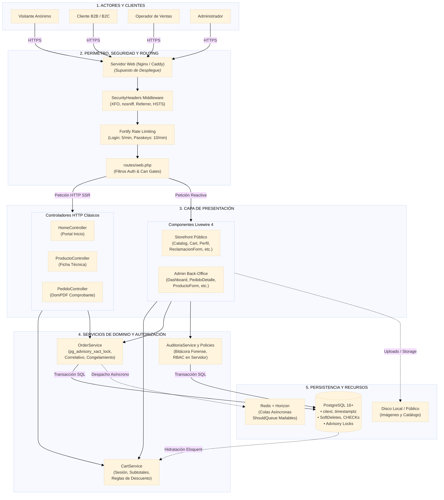
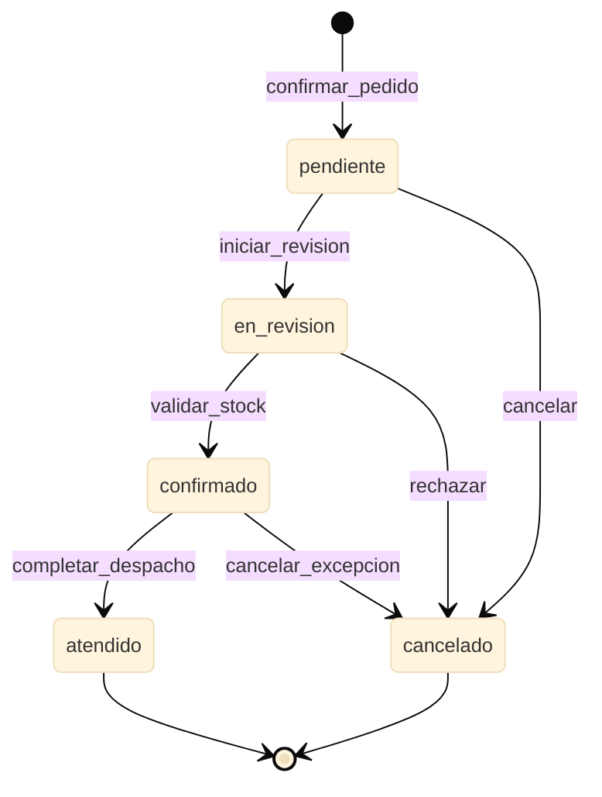
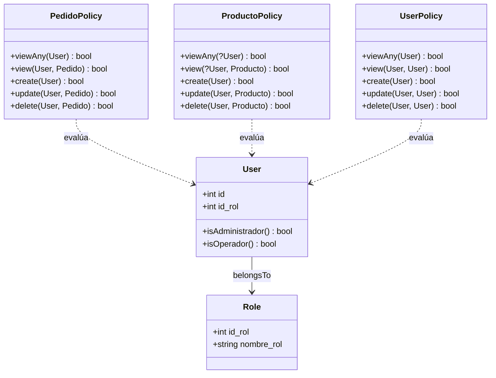

# Topología de Arquitectura, Patrones de Diseño y Seguridad

> **Ubicación:** `docs/webada/01-arquitectura/topologia-y-patron.md`  
> **Módulo:** Arquitectura de Software  
> **Fuente de Verdad:** `app/Http/Controllers/`, `app/Livewire/`, `app/Services/`, `app/Policies/`, `app/Providers/`, `app/Http/Middleware/`

---

## 1. Diagrama de Arquitectura del Sistema

La arquitectura de **Filam Centroplas** sigue un enfoque **Híbrido MVC Clásico + Component-Driven Reactivo (Livewire 4)**, dividido en capas lógicas estrictas para garantizar desacoplamiento, mantenibilidad y robustez transaccional.

### 1.1. Topología del Sistema (Flujo en Capas)



---

## 2. Explicación del Diseño Arquitectónico

### 2.1. Patrón Arquitectónico Adoptado
El sistema implementa una **Arquitectura en Capas Híbrida**:
1. **Páginas de Consulta Pesada y Descarga de Documentos (Controladores Clásicos):**
   - Vistas que requieren SSR estricto para indexación o streaming binario (como la generación del comprobante en PDF con DomPDF) se procesan mediante controladores HTTP estándar.
2. **Interfaces Interactivas y Consolas Administrativas (Livewire 4):**
   - Vistas dinámicas basadas en componentes reactivos que mantienen el estado en el servidor. El cliente no ejecuta un framework JavaScript SPA pesado; las interacciones se envían mediante peticiones HTTP compactas con payloads JSON cifrados que retornan diffs HTML pre-renderizados.

---

### 2.2. Controladores del Sistema (`app/Http/Controllers/`)

Los tres controladores principales cubren flujos especializados:

#### A. `HomeController` (`app/Http/Controllers/HomeController.php`)
- **Propósito:** Orquestar y cargar el contenido de la página de inicio comercial (`front.home`).
- **Acciones y Métodos:**
  - `index(): View`:
    - Consulta productos destacados: `Producto::query()->activos()->where('destacado', true)->orderBy('orden')->take(8)->get()`.
    - Consulta categorías activas ordenadas para el slider/rejilla.
    - Carga banners activos ordenados.
    - Carga bloques de `ContenidoInstitucional` indexados por `clave` (`keyBy('clave')`) para mostrar reseñas, misión y valores de la planta de Hualhuas.

#### B. `ProductoController` (`app/Http/Controllers/ProductoController.php`)
- **Propósito:** Mostrar la ficha técnica detallada del producto (`front.producto`).
- **Acciones y Métodos:**
  - `show(Producto $producto): View`:
    - Valida que el producto esté activo con `abort_unless($producto->activo, 404)`.
    - Carga ansiosa (*eager loading*) de relaciones: `$producto->load(['imagenes', 'categorias'])`.
    - Realiza una consulta contextual de productos relacionados pertenecientes a las mismas categorías, excluyendo el producto en visualización actual: `whereKeyNot($producto->getKey())` limitando a 4 registros.
    - Soporta *Route Model Binding* implícito mediante el campo `slug` (definido en `Producto::getRouteKeyName()`).

#### C. `PedidoController` (`app/Http/Controllers/PedidoController.php`)
- **Propósito:** Gestión y consulta de pedidos por parte del cliente y exportación del comprobante formal en PDF.
- **Acciones y Métodos:**
  - `index(Request $request): View`:
    - Resuelve el modelo `Cliente` del usuario autenticado (`$request->user()?->cliente`).
    - Pagina el historial de pedidos descendente por `fecha_emision` (10 por página). Si no hay cliente vinculado, devuelve una consulta vacía mediante `whereRaw('1 = 0')`.
  - `show(Pedido $pedido): View`:
    - Autoriza el acceso mediante `Gate::authorize('view', $pedido)`.
    - Carga ansiosa: `$pedido->load(['detalles', 'cliente', 'comprobante', 'historial'])`.
    - Resuelve el pedido mediante su correlativo en la ruta: `/pedido/{pedido:codigo_correlativo}`.
  - `comprobante(Pedido $pedido): Response`:
    - Autoriza mediante `Gate::authorize('view', $pedido)`.
    - Genera el PDF utilizando `Barryvdh\DomPDF\Facade\Pdf::loadView('pdf.comprobante', ['pedido' => $pedido])`.
    - Descarga el archivo con la nomenclatura `comprobante-PED-AAAA-NNNNN.pdf`.

---

### 2.3. Componentes Livewire (`app/Livewire/`)

La aplicación organiza sus componentes Livewire en dos grandes zonas: el **Storefront Público** y el **Panel Administrativo (`Admin/`)**.

#### 2.3.1. Storefront Público
1. **`AddToCart` (`app/Livewire/AddToCart.php`):**
   - Recibe la instancia de `Producto` y una propiedad `$cantidad` inicializada en 1.
   - Bloquea adiciones si `stock_estado === 'agotado_por_consultar'`.
   - Invoca a `CartService::add($idProducto, $cantidad)`.
   - Dispara el evento global `$this->dispatch('cart-updated')` para refrescar los componentes reactivos adyacentes.
2. **`CartCount` (`app/Livewire/CartCount.php`):**
   - Emplea el atributo de Livewire 4 `#[On('cart-updated')]` para re-renderizar de forma reactiva el contador numérico de items en la barra de navegación sin recargar la página.
3. **`Cart` (`app/Livewire/Cart.php`):**
   - Carga el carrito desde sesión mediante `CartService`.
   - Permite `incrementar()`, `decrementar()` y `eliminar()` items con emisión reactiva de `cart-updated`.
   - Pre-carga o captura los datos comerciales del cliente (`tipo_documento`, `numero_documento`, `razon_social`, `telefono`, `direccion`, `observaciones`).
   - Método `confirmar(CartService $cart, OrderService $orders)`:
     - Valida campos con regla `Rule::unique('clientes', 'numero_documento')` ignorando al propio cliente.
     - Persiste o actualiza el registro en la tabla `clientes` (`Cliente::updateOrCreate(...)`).
     - Invoca `OrderService::crear(...)` para generar atómicamente el pedido, líneas congeladas, bitácora y comprobante interno.
     - Encola correos asíncronos: `Mail::to(...)->send(new PedidoCliente($pedido))` y `Mail::to(config('filam.ventas_email'))->send(new PedidoOperativo($pedido))`.
     - Limpia el carrito con `CartService::clear()`.
     - Redirige mediante navegación SPA rápida: `$this->redirectRoute('pedido.show', ['pedido' => $pedido->codigo_correlativo], navigate: true)`.
4. **`Catalog` (`app/Livewire/Catalog.php`):**
   - Catálogo interactivo con filtrado por categoría seleccionada, búsqueda por texto libre y paginación reactiva con `WithPagination`.
5. **`Perfil` (`app/Livewire/Perfil.php`):**
   - Gestión de datos personales del usuario y datos tributarios/comerciales de facturación del cliente (`DNI`/`RUC`, razón social, dirección).
6. **`ReclamacionForm` (`app/Livewire/ReclamacionForm.php`):**
   - Formulario oficial del Libro de Reclamaciones conforme al D.S. 101-2022-PCM.
   - Genera correlativo formal único (`REC-AAAA-NNNNN`), calcula fecha límite legal (15 días hábiles), guarda consentimiento y despacha copia por correo al consumidor (`ReclamacionCopia`).
7. **`SolicitudStockForm` (`app/Livewire/SolicitudStockForm.php`):**
   - Modal interactivo para capturar intenciones de compra sobre productos con inventario agotado (`agotado_por_consultar`).
8. **`Contacto` (`app/Livewire/Contacto.php`):**
   - Formulario de contacto comercial con verificación de política de privacidad y envío de correo a la gerencia de ventas.

#### 2.3.2. Back-Office Administrativo (`app/Livewire/Admin/`)
Todos los componentes administrativos están protegidos por middleware `auth` y gate `can:access-admin`, utilizando las directivas de Livewire 4 `#[Layout('layouts::admin')]` y `#[Title('...')]`:

| Componente | Archivo | Responsabilidad Funcional |
|---|---|---|
| **Dashboard** | `Dashboard.php` | Muestra contadores agregados en tiempo real: productos, categorías, pedidos totales y usuarios registrados. |
| **ProductoIndex** | `ProductoIndex.php` | Búsqueda insensible a mayúsculas con `ilike`, conmutación en un clic del flag `activo` y eliminación suave (`SoftDeletes`). |
| **ProductoForm** | `ProductoForm.php` | Alta y edición con `WithFileUploads`. Valida SKU único, almacena imágenes en `storage/app/public/productos`, sincroniza categorías con `sync()` y gestiona la asignación de portada (`es_portada`). |
| **CategoriaIndex** | `CategoriaIndex.php` | CRUD de familias de producto, gestión de orden numérico y slug automático. |
| **PedidoIndex** | `PedidoIndex.php` | Bandeja de pedidos con filtrado dinámico por estado actual (`pendiente`, `en_revision`, etc.) y búsqueda por correlativo o razón social del cliente. |
| **PedidoDetalle** | `PedidoDetalle.php` | Inspección de líneas congeladas y ejecución de la **Máquina de Estados de Pedido** (ver sección 2.3.3). |
| **SolicitudStockIndex** | `SolicitudStockIndex.php` | Gestión y seguimiento de prospectos por quiebre de stock (`pendiente` -> `en_atencion` -> `atendida`). |
| **ReclamacionIndex** | `ReclamacionIndex.php` | Consola de atención del Libro de Reclamaciones con control de plazos legales de 15 días hábiles e ingreso de resolución final. |
| **DescuentoIndex** | `DescuentoIndex.php` | Definición de políticas porcentuales o fijas y vinculación temporal hacia clientes específicos (`ClienteDescuento`). |
| **ClienteIndex** | `ClienteIndex.php` | Directorio de clientes comerciales, cambio de estado activo/inactivo y consulta de historial. |
| **UsuarioIndex** | `UsuarioIndex.php` | Asignación de roles internos (`Administrador` u `Operador`) y reseteo de accesos. |
| **ContenidoIndex** | `ContenidoIndex.php` | Editor de textos institucionales (Misión, Visión, Políticas, Reseña Histórica). |
| **BannerIndex** | `BannerIndex.php` | Carga y ordenamiento visual de los banners del portal principal. |
| **ReporteIndex** | `ReporteIndex.php` | Reportes de volumen de pedidos, estados de atención y productos más solicitados. |

#### 2.3.3. Máquina de Estados del Pedido (`PedidoDetalle`)
El ciclo de vida del pedido en `PedidoDetalle.php` se implementa como una máquina de estados finita con transiciones estrictamente validadas en el servidor:



#### Detalle de Transiciones de la Máquina de Estados:

| Estado Origen | Estado Destino | Acción / Disparador | Actor Permitido | Efectos Secundarios |
|---|---|---|---|---|
| `[*]` | `pendiente` | `confirmar_pedido` | Cliente (vía `Cart.php`) | Inserta en `pedidos`, crea `comprobantes_internos` y bitácora inicial. |
| `pendiente` | `en_revision` | `iniciar_revision` | Operador / Administrador | Registra bitácora con operador y notas de evaluación. |
| `pendiente` | `cancelado` | `cancelar` | Operador / Administrador | Anula el pedido y registra motivo en bitácora. |
| `en_revision` | `confirmado` | `validar_stock` | Operador / Administrador | Aprueba cotización y disponibilidad en almacén. |
| `en_revision` | `cancelado` | `rechazar` | Operador / Administrador | Rechaza el pedido por discrepancia de inventario o crédito. |
| `confirmado` | `atendido` | `completar_despacho` | Operador / Administrador | **Estado Terminal Exitoso:** Despacho concluido en planta. Cierra transiciones. |
| `confirmado` | `cancelado` | `cancelar_excepcion` | Operador / Administrador | **Estado Terminal Anulado:** Anulación de fuerza mayor posterior a confirmación. |

Código de validación en `PedidoDetalle.php`:
```php
private const TRANSICIONES = [
    'pendiente' => ['en_revision', 'cancelado'],
    'en_revision' => ['confirmado', 'cancelado'],
    'confirmado' => ['atendido', 'cancelado'],
    'atendido' => [],
    'cancelado' => [],
];
```
Cada transición exitosa:
1. Actualiza `pedidos.estado_actual`.
2. Inserta un registro inmutable en `historial_estados_pedido` con el ID del operador y la nota explicativa.
3. Notifica a `AuditoriaService::registrar('pedidos', $pedido->id_pedido, 'cambio_estado', $estadoPrevio)`.

---

### 2.4. Capa de Servicios de Negocio (`app/Services/`)

La capa de servicios aísla la lógica de negocio crítica de las vistas y componentes.

#### A. `CartService` (`app/Services/CartService.php`)
- **Almacenamiento:** Mantiene el carrito en la sesión HTTP (`session()->get('cart', [])`) bajo la estructura clave-valor: `[id_producto => cantidad]`.
- **Métodos Principales:**
  - `add(int $idProducto, int $cantidad = 1): void`: Agrega o incrementa unidades garantizando un mínimo de 1.
  - `update(int $idProducto, int $cantidad): void`: Actualiza la cantidad o remueve el item si `cantidad <= 0`.
  - `remove(int $idProducto): void` y `clear(): void`: Eliminación selectiva o vaciado total.
  - `count(): int`: Suma total de unidades contenidas.
  - `items(): Collection`: Hidrata los productos desde PostgreSQL (`Producto::whereIn(...)`), calcula subtotales individuales redondeados a 2 decimales y descarta productos inexistentes o eliminados.
  - `subtotal(): float`: Suma aritmética de los subtotales de línea.
  - `descuento(?Cliente $cliente): float`:
    - Evalúa las asignaciones activas de descuento del cliente mediante `$cliente->descuentosVigentes()->first()`.
    - Verifica si el subtotal supera el `monto_minimo` estipulado en `PoliticaDescuento`.
    - Aplica la fórmula según `tipo_descuento`:
      - Porcentaje: `$subtotal * ($valor / 100)`.
      - Monto fijo: `(float) $valor`.
    - Retorna el descuento limitado al subtotal (`min($descuento, $subtotal)`).
  - `total(?Cliente $cliente): float`: `round($subtotal - $descuento, 2)`.

#### B. `OrderService` (`app/Services/OrderService.php`)
- **Atomicidad Transaccional:** Ejecuta la creación del pedido dentro de una transacción única de base de datos (`DB::transaction`).
- **PostgreSQL Advisory Locks:** 
  Para evitar condiciones de carrera (*race conditions*) en la generación del correlativo anual `PED-AAAA-NNNNN` cuando múltiples clientes confirman pedidos concurrentemente, ejecuta un bloqueo transaccional a nivel de motor:
  ```php
  if (DB::connection()->getDriverName() === 'pgsql') {
      DB::select('SELECT pg_advisory_xact_lock(?)', [20261006]);
  }
  ```
  El bloqueo se libera automáticamente al hacer commit o rollback de la transacción.
- **Congelamiento de Instantánea Comercial (*Price Freezing*):**
  Para proteger la integridad financiera y contractual frente a modificaciones futuras de precios en el catálogo, en `detalle_pedidos` se almacenan:
  - `nombre_comercial_congelado`: Nombre exacto del producto al comprar.
  - `precio_unitario_congelado`: Precio unitario base vigente.
  - `subtotal_linea`: Subtotal pactado.
- **Generación del Comprobante Interno:**
  Crea de forma síncrona el registro en `comprobantes_internos` con correlativo gemelo `CI-AAAA-NNNNN` y la leyenda legal obligatoria.

#### C. `AuditoriaService` (`app/Services/AuditoriaService.php`)
- **Trazabilidad Forense:**
  Centraliza el registro de actividades sensibles en la tabla inmutable `registro_auditoria`:
  ```php
  public function registrar(string $entidad, ?int $idRegistro, string $accion, ?string $estadoPrevio = null): void
  {
      RegistroAuditoria::create([
          'id_usuario' => auth()->id(),
          'entidad' => $entidad,
          'id_registro' => $idRegistro,
          'accion' => $accion,
          'estado_previo' => $estadoPrevio,
          'direccion_ip' => request()->ip(),
          'fecha_evento' => now(),
      ]);
  }
  ```

---

### 2.5. Autorización y Políticas RBAC (`app/Policies/`)

El modelo de control de acceso basado en roles (**RBAC**) se ejecuta estrictamente en el servidor:



#### Matriz de Políticas:
1. **`PedidoPolicy` (`app/Policies/PedidoPolicy.php`):**
   - `view(User $user, Pedido $pedido)`: Permite acceso a `Administrador`, `Operador`, o al `Cliente` propietario del pedido (`$user->cliente?->id_cliente === $pedido->id_cliente`).
   - `create(User $user)`: Requiere que el usuario tenga un perfil de cliente asociado (`$user->cliente !== null`).
   - `update(User $user, Pedido $pedido)`: Restringido exclusivamente a `Administrador` y `Operador`.
   - `delete(User $user, Pedido $pedido)`: Restringido estrictamente a `Administrador`.
2. **`ProductoPolicy` (`app/Policies/ProductoPolicy.php`):**
   - `view(?User $user, Producto $producto)`: Si el producto está `activo`, acceso público universal; si está inactivo, solo accesible por personal interno (`isAdministrador()` o `isOperador()`).
   - `create`, `update`, `delete`: Reservados únicamente al rol `Administrador`.
3. **`UserPolicy` (`app/Policies/UserPolicy.php`):**
   - `viewAny`, `create`, `update`: Exclusivo de `Administrador`.
   - `delete`: Exclusivo de `Administrador`, con la salvaguarda de impedir el suicidio de cuenta: `$user->id !== $model->id`.

---

## 3. Análisis de Seguridad y Proveedores de Servicios

### 3.1. `SecurityHeaders` Middleware (`app/Http/Middleware/SecurityHeaders.php`)
Registrado globalmente en `bootstrap/app.php` (`$middleware->append(SecurityHeaders::class)`), intercepta todas las respuestas HTTP salientes para inyectar cabeceras de endurecimiento perimetral:

```php
$response->headers->set('X-Content-Type-Options', 'nosniff');
$response->headers->set('X-Frame-Options', 'SAMEORIGIN');
$response->headers->set('Referrer-Policy', 'strict-origin-when-cross-origin');
$response->headers->set('Permissions-Policy', 'geolocation=(), microphone=(), camera=()');

if (app()->environment('production')) {
    $response->headers->set('Strict-Transport-Security', 'max-age=31536000; includeSubDomains');
}
```
- **`X-Content-Type-Options: nosniff`:** Previene ataques basados en MIME-sniffing.
- **`X-Frame-Options: SAMEORIGIN`:** Protege contra secuestro de clics (*Clickjacking*).
- **`Referrer-Policy: strict-origin-when-cross-origin`:** Limita la fuga de URLs en peticiones cruzadas a orígenes externos.
- **`Permissions-Policy: geolocation=(), microphone=(), camera=()`:** Inhabilita APIs invasivas del navegador (geolocalización, cámara y micrófono).
- **`Strict-Transport-Security` (HSTS):** Fuerza HTTPS por 1 año (`max-age=31536000; includeSubDomains`) exclusivamente en entorno de producción.
- **Nota de Seguridad Arquitectónica (CSP):** Actualmente `SecurityHeaders` **NO** implementa `Content-Security-Policy` (CSP). Se recomienda evaluar su incorporación progresiva en modo reporte (`Content-Security-Policy-Report-Only`) para mitigar vectores de inyección XSS sin romper scripts de Livewire 4 ni Vite.

---

### 3.2. `AppServiceProvider` (`app/Providers/AppServiceProvider.php`)
- **Definición de Gates Centrales:**
  - `access-admin`: Autoriza el ingreso a la consola `/admin` si el usuario es `Administrador` u `Operador`.
  - `manage-catalog`: Permite edición del catálogo solo a `Administrador`.
  - `manage-users`: Permite administración de usuarios solo a `Administrador`.
- **View Composer Global:**
  Inyecta en la plantilla maestra pública (`layouts.front`) la variable `$navCategorias` con las familias activas ordenadas para el menú de navegación, evitando duplicar consultas en cada controlador.

---

### 3.3. `FortifyServiceProvider` (`app/Providers/FortifyServiceProvider.php`)
Configura el backend de autenticación desacoplado de Fortify:
1. **Asignación de Acciones:** Mapea `CreateNewUser`, `UpdateUserProfileInformation`, `UpdateUserPassword` y `ResetUserPassword`.
2. **Vistas de Autenticación:** Direcciona a `auth.login`, `auth.register`, `auth.forgot-password` y `auth.reset-password`.
3. **Rate Limiting Defensivo:**
   - **`login`:** Máximo 5 intentos por minuto calculados por hash compuesto: `Str::transliterate(Str::lower($request->input('email')).'|'.$request->ip())`.
   - **`two-factor`:** Máximo 5 intentos por minuto vinculados al identificador temporal de sesión `login.id`.
   - **`passkeys`:** Máximo 10 solicitudes por minuto por identificador de credencial biométrica o sesión combinada con la dirección IP.

---

### 3.4. `HorizonServiceProvider` (`app/Providers/HorizonServiceProvider.php`)
- Extiende de `HorizonApplicationServiceProvider` para supervisar el orquestador de colas Redis (`QUEUE_CONNECTION=redis`).
- **Gate de Seguridad `viewHorizon` (`app/Providers/HorizonServiceProvider.php:21`):**
  ```php
  Gate::define('viewHorizon', function ($user = null) {
      return app()->environment('local') || ($user && $user->isAdministrador());
  });
  ```
  - En entorno `local`: Permite acceso irrestricto (incluso con `$user = null`, es decir, peticiones anónimas) para facilitar el monitoreo en desarrollo.
  - En entornos `production` / `staging`: Exige usuario autenticado con rol `Administrador` (`$user->isAdministrador() === true`). Operadores y clientes reciben código HTTP 403 Forbidden.
