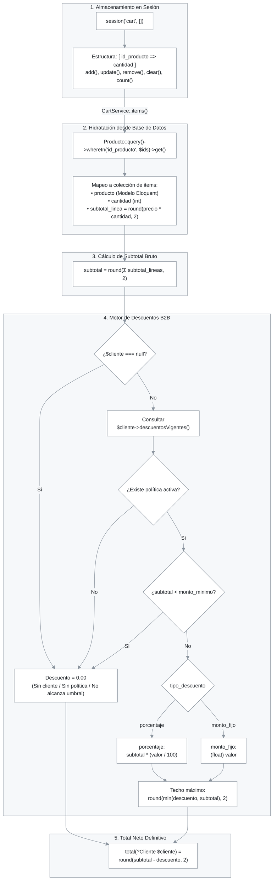

```mermaid
%%{init: {"theme":"base","themeVariables":{"fontFamily":"Arial, Helvetica, sans-serif","fontSize":"13px","lineColor":"#8b949e","arrowheadColor":"#8b949e","primaryColor":"#ffffff","primaryTextColor":"#1f2328","primaryBorderColor":"#8b949e","clusterBkg":"#f6f8fa","clusterBorder":"#8b949e","titleColor":"#1f2328","edgeLabelBackground":"#f6f8fa","tertiaryTextColor":"#1f2328"},"flowchart":{"htmlLabels":true,"padding":12,"wrappingWidth":230,"nodeSpacing":35,"rankSpacing":45}}}%%
flowchart TD
    START(["Llamada a Cart::confirmar()<br/>Inicia proceso de checkout"]) --> OS_CALL

    subgraph TX["Transacción Atómica (OrderService::crear en DB::transaction)"]
        OS_CALL["1. OrderService::crear($cliente, $items, $obs)"]
        
        T1["2. Cálculo de Montos Financieros<br/>• $subtotal = round(array_sum(array_column($items, 'subtotal')), 2)<br/>• $descuento = $this->cart->descuento($cliente)<br/>• $total_neto = round($subtotal - $descuento, 2)"]
        
        T2["3. Bloqueo Consultivo PostgreSQL<br/>SELECT pg_advisory_xact_lock(20261006)<br/>Serializa correlativo anual sin colisiones"]
        
        T3["4. Inserción de Pedido Maestro<br/>• codigo_correlativo: PED-AAAA-NNNNN<br/>• subtotal, descuento_total, total_neto<br/>• estado_actual: 'pendiente'"]
        
        T4["5. DetallePedido (Price Freezing)<br/>• nombre_comercial_congelado<br/>• precio_unitario_congelado<br/>• cantidad, subtotal_linea"]
        
        T5["6. Historial de Estados Inicial<br/>• estado: 'pendiente'<br/>• notas_bitacora: 'Pedido registrado por el cliente.'"]

        T6["7. Generación de ComprobanteInterno<br/>• numero_comprobante: CI-AAAA-NNNNN<br/>• leyenda: DOCUMENTO DE CONTROL INTERNO"]

        OS_CALL --> T1 --> T2 --> T3 --> T4 --> T5 --> T6
    end

    subgraph POST_TX["Post-Transacción en Servidor (Cart::confirmar)"]
        P1["8. Despacho Asíncrono de Correos<br/>• PedidoCliente (al comprador, ShouldQueue)<br/>• PedidoOperativo (a ventas, ShouldQueue)"]
        P2["9. Vaciado de Carrito en Sesión<br/>CartService::clear()"]
        P3["10. Redirección Reactiva SPA<br/>redirectRoute('pedido.show')"]
        P1 --> P2 --> P3
    end

    T6 -->|"Commit SQL Exitoso"| P1
    P3 --> FIN(["Fin de Confirmación"])
```

# Servicios Core del Dominio (CartService, OrderService, AuditoriaService)

> **Ubicación:** `docs/webada/02-modulos/servicios-core.md`  
> **Módulo:** Lógica de Negocio y Dominio  
> **Fuente de Verdad:** `app/Services/CartService.php`, `app/Services/OrderService.php`, `app/Services/AuditoriaService.php`

---

## 1. Visión General de la Capa de Servicios

La capa de servicios encapsula las reglas de negocio más críticas de **Filam Centroplas**, desacoplando la persistencia en base de datos y la gestión de sesiones HTTP de los componentes visuales de Livewire y controladores. 

Los tres servicios nucleares son:
1. **`CartService`:** Orquesta el estado volátil del carrito en sesión, calcula subtotales matemáticos y aplica el motor de políticas de descuento mayoristas B2B.
2. **`OrderService`:** Garantiza la persistencia atómica transaccional de pedidos bajo condiciones de alta concurrencia mediante *advisory locks* de PostgreSQL, congela instantáneas comerciales (*price freezing*) y emite comprobantes internos de control correlacionados.
3. **`AuditoriaService`:** Proporciona trazabilidad inmutable y forense sobre eventos sensibles del sistema (cambios de estado, manipulaciones de catálogo y accesos).

---

## 2. `CartService` (`app/Services/CartService.php`)

### 2.1. Arquitectura de Almacenamiento en Sesión
El carrito se almacena de forma ligera en la sesión del cliente (`session()->get('cart', [])`) bajo la clave privada `private const SESSION_KEY = 'cart'`.

La estructura interna es un diccionario asociativo:
```php
/** @var array<int, int> $cart [id_producto => cantidad] */
[
    1 => 10,  // id_producto: 1, cantidad: 10
    4 => 2,   // id_producto: 4, cantidad: 2
]
```
Este diseño minimiza el tamaño de la cookie de sesión y el almacenamiento en Redis, delegando la hidratación de precios, nombres e imágenes a consultas puntuales contra PostgreSQL.

---

### 2.2. Diagrama de Flujo del Motor de Carrito y Descuentos



---

### 2.3. Catálogo de Métodos y Firmas

#### `raw(): array<int, int>`
- **Firma:** `public function raw(): array`
- **Descripción:** Retorna el array primitivo de sesión con los IDs de producto y sus cantidades.

#### `add(int $idProducto, int $cantidad = 1): void`
- **Firma:** `public function add(int $idProducto, int $cantidad = 1): void`
- **Comportamiento:** Si el producto ya existe en sesión, suma `$cantidad`; si no existe, lo inicializa. Aplica `max(1, ...)` para evitar cantidades negativas o cero.

#### `update(int $idProducto, int $cantidad): void`
- **Firma:** `public function update(int $idProducto, int $cantidad): void`
- **Comportamiento:** Si `$cantidad <= 0`, remueve la clave del array (`unset`); en caso contrario, fija el nuevo valor numérico.

#### `remove(int $idProducto): void`
- **Firma:** `public function remove(int $idProducto): void`
- **Comportamiento:** Elimina definitivamente el producto del carrito en sesión.

#### `clear(): void`
- **Firma:** `public function clear(): void`
- **Comportamiento:** Invoca `session()->forget(self::SESSION_KEY)`.

#### `count(): int`
- **Firma:** `public function count(): int`
- **Comportamiento:** Retorna la suma total de unidades físicas (`array_sum($this->raw())`).

#### `items(): Collection`
- **Firma:** `public function items(): Collection`
- **Retorno:** `Collection<int, array{producto: Producto, cantidad: int, subtotal: float}>`
- **Lógica de Hidratación:**
  1. Si el array de sesión está vacío, retorna `collect()`.
  2. Consulta la base de datos por los productos activos: `Producto::query()->whereIn('id_producto', array_keys($cart))->get()->keyBy('id_producto')`.
  3. Mapea cada elemento descartando productos eliminados o no encontrados (`filter()`).
  4. Calcula el subtotal de línea redondeado a 2 decimales: `round((float) $producto->precio_base * $cantidad, 2)`.

#### `subtotal(): float`
- **Firma:** `public function subtotal(): float`
- **Fórmula:** `subtotal = round(Σ subtotal_lineas, 2)`

#### `descuento(?Cliente $cliente): float`
- **Firma:** `public function descuento(?Cliente $cliente): float`
- **Motor de Descuentos Preferenciales B2B:**
  1. Si `$cliente` es `null`, retorna `0.0`.
  2. Consulta la asignación de descuento activa mediante el scope `$cliente->descuentosVigentes()->first()`.
  3. Si no existe asignación o la política vinculada está inactiva, retorna `0.0`.
  4. **Validación de Umbral Mínimo:** Si la política define `monto_minimo` y `subtotal < monto_minimo`, el descuento no aplica y retorna `0.0`.
  5. **Aplicación de Fórmula según Tipo:**
     - Si `tipo_descuento === 'porcentaje'`:
       `descuento = subtotal * (valor / 100)`
     - Si `tipo_descuento === 'monto_fijo'`:
       `descuento = (float) valor`
  6. **Salvaguarda de Techo:** El descuento nunca puede superar el subtotal:
     `descuento_final = round(min(descuento, subtotal), 2)`

#### `total(?Cliente $cliente): float`
- **Firma:** `public function total(?Cliente $cliente): float`
- **Fórmula:** `total = round(subtotal - descuento, 2)`

---

## 3. `OrderService` (`app/Services/OrderService.php`)

### 3.1. Arquitectura Transaccional y Concurrencia
El proceso de checkout y confirmación de pedidos es una operación de alta criticidad financiera. `OrderService` resuelve dos desafíos arquitectónicos esenciales:
1. **Atomicidad ACID:** Si falla la inserción de las líneas congeladas o el comprobante interno, se ejecuta un rollback total mediante `DB::transaction`.
2. **Eliminación de Condiciones de Carrera (*Race Conditions*):** Para evitar que dos clientes concurrentes obtengan el mismo correlativo `PED-AAAA-NNNNN` en el mismo milisegundo, se utiliza un bloqueo consultivo exclusivo a nivel de transacción en PostgreSQL:
   ```php
   if (DB::connection()->getDriverName() === 'pgsql') {
       DB::select('SELECT pg_advisory_xact_lock(?)', [20261006]);
   }
   ```
   El identificador numérico `20261006` serializa las solicitudes de generación de correlativo sin bloquear lecturas generales en la tabla `pedidos`.

---

### 3.2. Diagrama de Flujo Transaccional

### 3.2. Diagrama de Flujo Transaccional



---

### 3.3. Catálogo de Métodos y Firmas

#### `crear(Cliente $cliente, array $items, ?string $observacionesEntrega = null): Pedido`
- **Firma:** `public function crear(Cliente $cliente, array $items, ?string $observacionesEntrega = null): Pedido`
- **Parámetros:**
  - `Cliente $cliente`: Instancia del cliente comercial titular.
  - `array $items`: Colección de items retornados por `CartService::items()`.
  - `?string $observacionesEntrega`: Indicaciones de logística y transporte en obra.
- **Retorno:** Instancia del modelo `Pedido` con relaciones cargadas (`loadMissing(['detalles', 'cliente', 'comprobante'])`).
- **Secuencia de Pasos Transaccionales:**
  1. Inicia `DB::transaction(...)`.
  2. Calcula montos: `$subtotal`, `$descuento = $this->cart->descuento($cliente)` y `$total = round($subtotal - $descuento, 2)`.
  3. Ejecuta `siguienteCorrelativo()` bajo advisory lock de PostgreSQL.
  4. Crea `Pedido::create([...])` con `descuento_total`, `total_neto`, `estado_actual = 'pendiente'` y `fecha_emision = now()`.
  5. **Bucle de Congelamiento Comercial (*Price Freezing*):**
     Para cada item, inserta en `detalle_pedidos`:
     - `nombre_comercial_congelado = $item['producto']->nombre`
     - `precio_unitario_congelado = $item['producto']->precio_base`
     - `cantidad = $item['cantidad']`
     - `subtotal_linea = $item['subtotal']`
  6. Inserta en `historial_estados_pedido`:
     - `estado = 'pendiente'`, `notas_bitacora = 'Pedido registrado por el cliente.'`, `fecha_cambio = now()`.
  7. Emite 1 a 1 el registro en `comprobantes_internos`:
     - `numero_comprobante = str_replace('PED-', 'CI-', $pedido->codigo_correlativo)`
     - `fecha_emision = now()`
     - `leyenda_legal = 'DOCUMENTO DE CONTROL INTERNO - NO VALIDO PARA FINES TRIBUTARIOS'`
  8. Finaliza la transacción y retorna el pedido completo.

> **Nota de Desacoplamiento Arquitectónico:**  
> Las acciones colaterales como el envío de correos asíncronos (`PedidoCliente`, `PedidoOperativo`) y la limpieza de sesión (`CartService::clear()`) se ejecutan en `App\Livewire\Cart::confirmar()` **inmediatamente después del commit exitoso** de la transacción de base de datos. De este modo, si ocurre un fallo en base de datos o en la concurrencia, no se emiten correos espurios ni se pierde el contenido del carrito del cliente. `AuditoriaService` no interviene en la creación inicial del pedido (interviene en `PedidoDetalle` ante transiciones de estado).

#### `siguienteCorrelativo(): string` (Privado)
- **Firma:** `private function siguienteCorrelativo(): string`
- **Lógica:**
  - Obtiene el año actual (`now()->year`).
  - Define el prefijo anual: `PED-AAAA-`.
  - Ejecuta advisory lock en PostgreSQL (`SELECT pg_advisory_xact_lock(20261006)`).
  - Consulta: `Pedido::query()->where('codigo_correlativo', 'like', $prefijo.'%')->max('codigo_correlativo')`.
  - Extrae los últimos 5 dígitos numéricos, suma 1 y formatea a 5 dígitos con ceros a la izquierda (`str_pad((string) $secuencia, 5, '0', STR_PAD_LEFT)`).
  - Retorno: E.g. `PED-2026-00001`.

---

## 4. `AuditoriaService` (`app/Services/AuditoriaService.php`)

### 4.1. Responsabilidad y Trazabilidad Forense
Centraliza el registro inmutable de acciones administrativas y transaccionales para auditoría de seguridad y resolución de controversias operativas.

### 4.2. Firma y Parámetros

```php
public function registrar(
    string $entidad,
    ?int $idRegistro,
    string $accion,
    ?string $estadoPrevio = null
): void
```

- **Parámetros:**
  - `string $entidad`: Nombre de la tabla afectada (e.g. `'pedidos'`, `'productos'`).
  - `?int $idRegistro`: Identificador del registro modificado.
  - `string $accion`: Verbo de la operación realizada (e.g. `'cambio_estado'`, `'guardar'`, `'eliminar'`).
  - `?string $estadoPrevio`: Snapshot o estado anterior del objeto antes de la modificación (e.g. `'pendiente'`).

### 4.3. Implementación Interna
```php
RegistroAuditoria::create([
    'id_usuario' => auth()->id(),
    'entidad' => $entidad,
    'id_registro' => $idRegistro,
    'accion' => $accion,
    'estado_previo' => $estadoPrevio,
    'direccion_ip' => request()->ip(),
    'fecha_evento' => now(),
]);
```
- La tabla `registro_auditoria` tiene `$timestamps = false` y persiste marcas `timestamptz` inmutables.
- Captura de forma transparente la dirección IP del operador (`request()->ip()`) y el ID del usuario en sesión (`auth()->id()`), soportando llamadas desatendidas (`null` para procesos de sistema).
