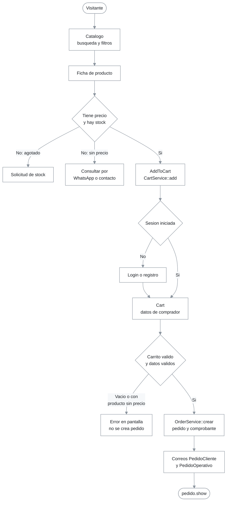
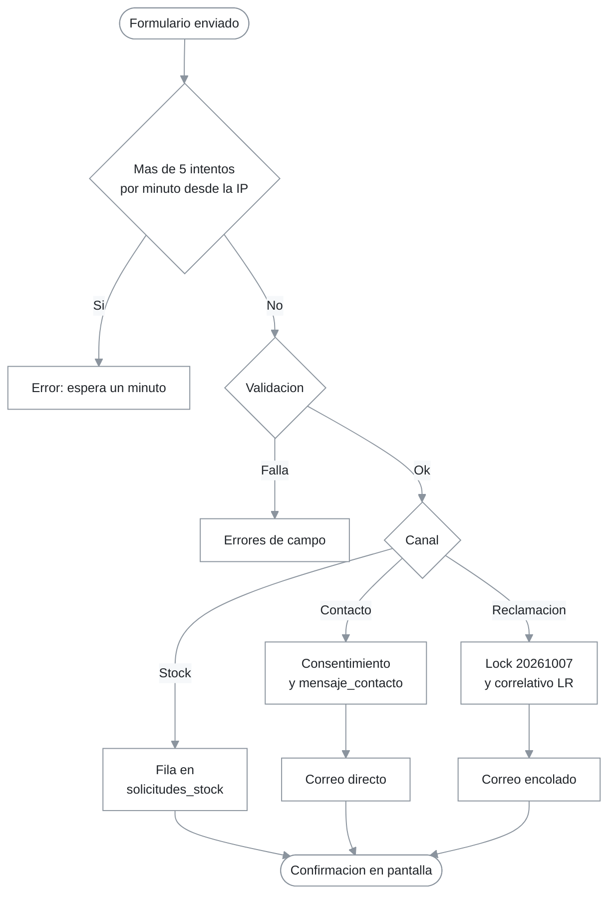

# Módulo storefront público y canales de atención

## 1. Resumen y propósito de negocio

El storefront es la cara pública de FILAM CENTROPLAST: muestra el catálogo de tuberías y accesorios, permite armar un carrito, registrar una solicitud de compra (no un pago en línea) y atender al cliente por tres canales: formulario de contacto, solicitud de stock y Libro de Reclamaciones. La compra termina en un pedido en estado `pendiente` y un comprobante interno; no hay pasarela de pago ni facturación electrónica (`docs/MATRIZ_REQUISITOS.md`, sección «Exclusiones verificadas»).

El módulo mezcla dos estilos de forma deliberada ([ADR-0003](../../decisiones/0003-livewire-4-server-driven-ui.md)): páginas servidas por controladores o `Route::view` (SEO y descarga de PDF) y componentes Livewire para lo interactivo. El estado del carrito vive en la sesión HTTP ([ADR-0004](../../decisiones/0004-carrito-en-sesion-http.md)).

`app/Http/Controllers/Controller.php` es la clase base abstracta de los tres controladores; su cuerpo está vacío (`Controller.php:5-8`). Es trivial y no tiene ficha propia: se declara en el `alcance` solo para dejarla cubierta.

## 2. Requisitos que implementa

Los títulos provienen de la ERS v1.4 (`docs/Ers_FilamCentroPlas_v1.4.docx`); el estado «Implementado» por rango proviene de `docs/MATRIZ_REQUISITOS.md`.

| Requisito | Cómo lo cumple | Evidencia |
|---|---|---|
| RF-08 Navegación pública del catálogo | `Catalog` paginado de 9 en 9 sobre productos activos | `Catalog::render()` |
| RF-09 Búsqueda por texto | `ilike` sobre `nombre`, `codigo_sku` y `descripcion_corta` | `app/Livewire/Catalog.php:50-52` |
| RF-10 Filtro por categoría | Filtro por `categorias.slug`, sincronizado con la URL (`?categoria=`) | `app/Livewire/Catalog.php:18-19,55-58` |
| RF-11 URL canónica | `/producto/{producto}` resuelta por `slug` | `Producto::getRouteKeyName()` |
| RF-12, RF-14 Ficha y disponibilidad | Imágenes, categorías, relacionados y badge de stock | `ProductoController::show()`, `resources/views/components/stock-badge.blade.php` |
| RF-15 Solicitud de stock | `SolicitudStockForm` crea una fila en `solicitudes_stock` | `SolicitudStockForm::enviar()` |
| RF-23 Perfil y datos de contacto | `Perfil` edita cuenta, datos de comprador y contraseña | `Perfil::guardar()`, `Perfil::cambiarPassword()` |
| RF-24, RF-25, RF-26 Historial, detalle y comprobante | `PedidoController` con autorización por política | `PedidoController::index()`, `show()`, `comprobante()` |
| RF-27, RF-28, RF-29 Carrito | `AddToCart`, `Cart` y `CartCount` sobre `CartService` | sección 5 y [03-servicios-core.md](03-servicios-core.md) |
| RF-30, RF-31, RF-32, RF-33, RF-35 Solicitud de compra | `Cart::confirmar()` delega en `OrderService::crear()` y envía los correos | `Cart::confirmar()` |
| RF-34 Pantalla de confirmación | Redirección a `pedido.show` con mensaje flash `pedido_ok` | `Cart::confirmar()` |
| RF-53 Página principal | `HomeController::index()` con destacados, categorías, banners y contenido | `HomeController::index()` |
| RF-54 Contacto con validación | `Contacto::enviar()` | `Contacto::enviar()` |
| RF-55 Enlace a WhatsApp | Presente en `layouts/front.blade.php`, `add-to-cart.blade.php` y `front/producto.blade.php` | No verificado: número exacto de los enlaces (solo se comprobó su presencia) |
| RF-58 Libro de Reclamaciones | `ReclamacionForm::registrar()` | `ReclamacionForm::registrar()` |
| RF-59 Términos y claridad de precios | Vistas `terminos` y `privacidad`; «Precio por consultar» cuando el precio es nulo | `Producto::precioFormateado()` |

No se declaran como cubiertos RF-13 (zoom de galería: comportamiento de vista, no verificado), RF-18 (solo existe el límite de 5 envíos por minuto, RN-SF-07) ni RF-56/RF-57 (el consentimiento solo existe en `Contacto`, hallazgo 3).

## 3. Rutas y puntos de entrada

Verificado leyendo `routes/web.php`. `php artisan route:list` no se pudo ejecutar en la auditoría (sin PHP disponible): ejecutarlo antes de aprobar el PR.

| Método | URI | Nombre | Componente o controlador | Middleware |
|---|---|---|---|---|
| GET | `/` | `inicio` | `HomeController::index` (`routes/web.php:22`) | ninguno |
| GET | `/catalogo` | `catalogo` | `Route::view` `front.catalogo`, embebe `<livewire:catalog />` | ninguno |
| GET | `/contacto` | `contacto` | `Route::view` `front.contacto`, embebe `Contacto` | ninguno |
| GET | `/terminos` | `terminos` | `Route::view` `front.terminos` | ninguno |
| GET | `/descargas` | `descargas` | `Route::view` `front.descargas` | ninguno |
| GET | `/privacidad` | `privacidad` | `Route::view` `front.privacidad` | ninguno |
| GET | `/libro-reclamaciones` | `reclamaciones.create` | `Route::view` `front.reclamaciones`, embebe `ReclamacionForm` | ninguno |
| GET | `/producto/{producto}` | `producto.show` | `ProductoController::show` | ninguno |
| GET | `/home` | `home` | `Route::view` `home` | `auth` |
| GET | `/carrito` | `carrito` | `Route::view` `front.carrito`, embebe `Cart` | `auth` |
| GET | `/mi-cuenta/perfil` | `perfil` | `Route::view` `front.perfil`, embebe `Perfil` | `auth` |
| GET | `/mi-cuenta/pedidos` | `pedidos.index` | `PedidoController::index` | `auth` |
| GET | `/pedido/{pedido:codigo_correlativo}` | `pedido.show` | `PedidoController::show` | `auth` |
| GET | `/pedido/{pedido:codigo_correlativo}/comprobante` | `pedido.comprobante` | `PedidoController::comprobante` | `auth` |

Notas:

- `AddToCart` y `SolicitudStockForm` no tienen ruta propia: se embeben en `resources/views/front/producto.blade.php` (líneas 58 y 63). `CartCount` se embebe en `resources/views/layouts/front.blade.php`.
- Las rutas de autenticación (`/login`, `/register`, recuperación de contraseña) las registra Fortify: ver [04-autenticacion-fortify.md](04-autenticacion-fortify.md).
- Ninguna ruta renderiza `resources/views/welcome.blade.php` (hallazgo 7).

## 4. Diagrama de flujo

Lectura: el camino principal va de catálogo a ficha, carrito y pedido. Hay tres salidas alternas: producto agotado (solicitud de stock), producto sin precio (consulta por WhatsApp o contacto) y carrito vacío o con producto sin precio al confirmar (error sin crear pedido). Un visitante anónimo puede agregar productos (`AddToCart` no consulta `auth`), pero `/carrito` lo redirige a login.

Lectura: los tres canales comparten el límite por IP y la validación, y se bifurcan en la persistencia. Solo `Contacto` registra consentimiento, solo la reclamación genera correlativo bajo lock y la solicitud de stock no envía correo.

## 5. Catálogo de componentes

### 5.1. `HomeController` (`app/Http/Controllers/HomeController.php`)

`index()` arma la portada: hasta 8 productos activos y destacados ordenados por `orden`, categorías activas, banners activos y el contenido institucional indexado por `clave`. Vista: `resources/views/front/home.blade.php`. Sin autorización (ruta pública).

### 5.2. `ProductoController` (`app/Http/Controllers/ProductoController.php`)

`show(Producto $producto)` responde 404 si el producto no está activo, carga imágenes y categorías y consulta hasta 4 relacionados que compartan categoría. Si el producto no tiene categorías, la cláusula `when` se omite y el listado puede traer cualquier producto activo. Vista: `resources/views/front/producto.blade.php`.

### 5.3. `PedidoController` (`app/Http/Controllers/PedidoController.php`)

- `index(Request)`: lista de a 10 los pedidos del cliente del usuario; si no tiene `Cliente`, devuelve página vacía con `whereRaw('1 = 0')`.
- `show(Pedido)`: `Gate::authorize('view', $pedido)` y carga `detalles`, `cliente`, `comprobante` e `historial`.
- `comprobante(Pedido)`: mismo `authorize` y descarga `comprobante-<codigo>.pdf` generado con DomPDF desde `resources/views/pdf/comprobante.blade.php`.
- Autorización: `PedidoPolicy::view()` permite al personal interno y al cliente dueño del pedido (`app/Policies/PedidoPolicy.php:15-22`).

### 5.4. `Catalog` (`app/Livewire/Catalog.php`)

Propiedades `$search` (`?q=`) y `$categoria` (`?categoria=`) con `#[Url]`; usa `WithPagination`. `limpiarFiltros()`; `updatingSearch()` y `updatingCategoria()` reinician la página. Consulta: activos, orden por `orden` y `nombre`, `paginate(9)`. Vista: `resources/views/livewire/catalog.blade.php`.

### 5.5. `AddToCart` (`app/Livewire/AddToCart.php`)

`agregar(CartService $cart)` rechaza productos sin precio y `agotado_por_consultar` con un error sobre `cantidad`; si pasa, llama a `CartService::add()` con `max(1, cantidad)`, reinicia la cantidad y emite `cart-updated`. Vista: `resources/views/livewire/add-to-cart.blade.php`.

### 5.6. `CartCount` (`app/Livewire/CartCount.php`)

Insignia con la suma de cantidades; escucha `cart-updated` (`#[On]`) y lee `CartService::count()`.

### 5.7. `Cart` (`app/Livewire/Cart.php`)

- Propiedades: `tipo_documento` (`DNI` por defecto), `numero_documento`, `razon_social`, `telefono`, `direccion`, `observaciones`; `mount()` las precarga desde el `Cliente` o, si no existe, usa el nombre del usuario como razón social.
- `incrementar()`, `decrementar()` y `eliminar()` delegan en `CartService` y emiten `cart-updated`; decrementar bajo 1 elimina la línea porque `CartService::update()` borra cantidades `<= 0`.
- `confirmar(CartService, OrderService)`: rechaza carrito vacío y con productos sin precio, valida el comprador, hace `updateOrCreate` del `Cliente`, llama a `OrderService::crear()`, envía los dos correos, vacía el carrito y redirige a `pedido.show`.
- Validación: `tipo_documento` en `DNI,RUC`; `numero_documento` obligatorio, máx. 20 y único salvo el propio cliente; `razon_social` obligatoria, máx. 150; `observaciones` máx. 1000.
- Autorización solo por la ruta (`auth`). Vista: `resources/views/livewire/cart.blade.php`.

### 5.8. `Perfil` (`app/Livewire/Perfil.php`)

`guardar()` valida y actualiza `users.name` y `users.email` (único salvo el propio) y hace `updateOrCreate` del `Cliente`. `cambiarPassword()` exige la contraseña actual (`Hash::check()`), nueva de mínimo 8 y confirmación. No usa las acciones de Fortify (ver [04-autenticacion-fortify.md](04-autenticacion-fortify.md)). Vista: `resources/views/livewire/perfil.blade.php`.

### 5.9. `Contacto` (`app/Livewire/Contacto.php`)

`enviar()`: límite de 5 intentos por minuto por IP (`Contacto.php:57-63`), validación con `acepta`, registro del consentimiento (finalidad `contacto`, versión de política `1.0`, IP y user agent), creación de `MensajeContacto` y envío de `ContactoMensaje` a `config('mail.from.address')` (`Contacto.php:87`). Vista: `resources/views/livewire/contacto.blade.php`.

### 5.10. `ReclamacionForm` (`app/Livewire/ReclamacionForm.php`)

Validación: `tipo_documento` en `DNI,CE,RUC`; `tipo` en `queja,reclamo`; `detalle` de 10 a 2000 caracteres; `acepta` obligatorio. `registrar()`: límite de 5 intentos por minuto por IP; en transacción toma `pg_advisory_xact_lock(20261007)` solo si el driver es `pgsql` y calcula `LR-<año>-<NNNN>` desde el máximo del año; fija `fecha_limite_respuesta` con `now()->addWeekdays(15)` (`ReclamacionForm.php:101`); tras la transacción envía `ReclamacionCopia` al consumidor y a `config('filam.ventas_email')` (`ReclamacionForm.php:106`). Vista: `resources/views/livewire/reclamacion-form.blade.php`.

### 5.11. `SolicitudStockForm` (`app/Livewire/SolicitudStockForm.php`)

`mount()` precarga nombre y correo si hay sesión. `enviar()`: límite de 5 intentos por minuto por IP, validación y creación de `SolicitudStock` en estado `pendiente`, con `id_cliente` si el usuario tiene `Cliente`. No envía correo. Vista: `resources/views/livewire/solicitud-stock-form.blade.php`.

### 5.12. Vistas y capa de presentación

| Vista | Qué hace |
|---|---|
| `resources/views/layouts/front.blade.php` | Layout público; recibe `navCategorias` desde un `View::composer` (`app/Providers/AppServiceProvider.php:32-37`) y embebe `CartCount` |
| `resources/views/front/*.blade.php` | Páginas servidas por controlador o `Route::view` |
| `resources/views/livewire/*.blade.php` | Plantillas de los componentes públicos (excluye `admin/`) |
| `resources/views/home.blade.php` | Pantalla tras login; solo se renderiza en `/home` (hallazgo 7) |
| `resources/views/welcome.blade.php` | Plantilla por defecto de Laravel, sin ruta (hallazgo 7) |

## 6. Reglas de negocio

| Código | Regla | Cita en código |
|---|---|---|
| RN-SF-01 | Un producto inactivo no es visible: la ficha responde 404 y catálogo, portada y relacionados filtran `activo` | `ProductoController::show()`, `Producto::scopeActivos()` |
| RN-SF-02 | Un producto sin precio no se agrega al carrito ni se confirma en un pedido | `AddToCart::agregar()`, `Cart::confirmar()` |
| RN-SF-03 | Un producto `agotado_por_consultar` no se agrega al carrito; se ofrece la solicitud de stock | `AddToCart::agregar()` |
| RN-SF-04 | Carrito, perfil, historial, detalle y comprobante exigen sesión | `routes/web.php:38-45` |
| RN-SF-05 | El número de documento del comprador es único entre clientes | `Cart::confirmar()`, `Perfil::guardar()` |
| RN-SF-06 | Un cliente solo ve sus pedidos y comprobantes; el personal interno ve todos | `PedidoPolicy::view()` |
| RN-SF-07 | Contacto, reclamación y solicitud de stock se limitan a 5 envíos por minuto y por IP | `Contacto::enviar()`, `ReclamacionForm::registrar()`, `SolicitudStockForm::enviar()` |
| RN-SF-08 | El mensaje de contacto exige aceptar la política y deja constancia del consentimiento | `Contacto::enviar()` |
| RN-SF-09 | El código de reclamación es `LR-AAAA-NNNN`, reinicia cada año y se asigna bajo el lock `20261007` | `ReclamacionForm::registrar()` |
| RN-SF-10 | El plazo de respuesta es de 15 días hábiles con `addWeekdays(15)` (excluye sábados y domingos, no feriados) | `ReclamacionForm.php:101` |
| RN-SF-11 | Una solicitud de stock nace en estado `pendiente` | `SolicitudStockForm::enviar()` |
| RN-SF-12 | Cambiar la contraseña exige la actual correcta y una nueva de al menos 8 caracteres | `Perfil::cambiarPassword()` |
| RN-SF-13 | La portada muestra como máximo 8 destacados | `HomeController::index()` |
| RN-SF-14 | La ficha muestra como máximo 4 relacionados | `ProductoController::show()` |

## 7. Persistencia

| Tabla | Modelo | Uso en el módulo |
|---|---|---|
| `productos`, `categorias`, `producto_categoria`, `imagenes_producto` | `Producto`, `Categoria`, `ImagenProducto` | Lectura en portada, catálogo y ficha |
| `banners`, `contenido_institucional` | `Banner`, `ContenidoInstitucional` | Lectura en la portada |
| `users`, `clientes` | `User`, `Cliente` | `Perfil` y `Cart` actualizan `users` y hacen `updateOrCreate` de `clientes` |
| `pedidos`, `detalle_pedidos`, `historial_estados_pedido`, `comprobantes_internos` | `Pedido` y asociados | Escritas por `OrderService::crear()`; leídas por `PedidoController` |
| `mensajes_contacto`, `consentimientos_datos` | `MensajeContacto`, `ConsentimientoDato` | Escritas por `Contacto::enviar()` |
| `reclamaciones` | `Reclamacion` | Escrita por `ReclamacionForm::registrar()` |
| `solicitudes_stock` | `SolicitudStock` | Escrita por `SolicitudStockForm::enviar()` |
| Sesión (`cart`) | — | Estado del carrito; driver por defecto `database` (`.env.example:30`) |

Detalle de columnas: [02-base-de-datos.md](../01-arquitectura/02-base-de-datos.md).

## 8. Correo, colas y notificaciones

| Clase | Destino | ¿`ShouldQueue`? | Disparador |
|---|---|---|---|
| `PedidoCliente` | Correo del usuario autenticado; vista `emails.pedido-cliente` | Sí (`app/Mail/PedidoCliente.php:13`) | `Cart::confirmar()` |
| `PedidoOperativo` | `config('filam.ventas_email')`; vista `emails.pedido-operativo` | Sí (`app/Mail/PedidoOperativo.php:13`) | `Cart::confirmar()` |
| `ReclamacionCopia` | Consumidor y `config('filam.ventas_email')`; vista `emails.reclamacion` | Sí (`app/Mail/ReclamacionCopia.php:13`) | `ReclamacionForm::registrar()` |
| `ContactoMensaje` | `config('mail.from.address')`; vista `emails.contacto` | No (solo `Queueable`) | `Contacto::enviar()` |

Los tres primeros implementan `ShouldQueue`, por lo que `Mail::send()` los encola en la conexión configurada: `.env.example` declara `QUEUE_CONNECTION=redis` y Horizon supervisa la cola (`app/Providers/HorizonServiceProvider.php`). `ContactoMensaje` se envía dentro de la petición.

## 9. Pruebas que lo cubren

Usan Livewire Testing y `Mail::fake()`. Ejecutar con `php artisan test --compact`; el resultado de la última ejecución no se pudo verificar en esta auditoría (sin PHP).

| Prueba | Archivo | Qué demuestra |
|---|---|---|
| `test_home_lists_only_featured_products` | `tests/Feature/CatalogTest.php` | La portada solo lista destacados |
| `test_catalog_lists_only_active_products`, `test_catalog_search_filters_results`, `test_catalog_filters_by_category`, `test_catalog_page_renders_embedded_component` | `tests/Feature/CatalogTest.php` | RN-SF-01, búsqueda y filtro |
| `test_product_detail_loads_by_slug`, `test_product_without_price_shows_por_consultar`, `test_downloads_page_links_both_documents` | `tests/Feature/CatalogTest.php` | Ficha por slug, precio por consultar, descargas |
| `test_cart_page_requires_authentication`, `test_add_to_cart_stores_the_product` | `tests/Feature/CartTest.php` | RN-SF-04, clave de sesión `cart` |
| `test_confirmar_creates_order_with_frozen_prices_and_comprobante`, `test_preferential_discount_is_applied` | `tests/Feature/CartTest.php` | Pedido, precios congelados, comprobante, correos y carrito vacío |
| `test_product_without_price_cannot_be_added_to_cart`, `test_confirming_order_with_unpriced_product_is_rejected` | `tests/Feature/CartTest.php` | RN-SF-02 |
| `test_client_can_view_and_download_their_comprobante`, `test_client_cannot_view_another_clients_order` | `tests/Feature/PedidoTest.php` | RN-SF-06 |
| `test_cliente_solo_ve_sus_propios_pedidos` | `tests/Feature/RbacTest.php` | `PedidoPolicy::view` aislada |
| `test_perfil_page_requires_authentication`, `test_perfil_page_renders_for_authenticated_user`, `test_user_can_update_profile_and_contact_data`, `test_user_can_change_password_with_correct_current_password`, `test_password_change_fails_with_wrong_current_password`, `test_document_number_must_be_unique_across_clients` | `tests/Feature/PerfilTest.php` | RN-SF-05 y RN-SF-12 |
| `test_contact_form_stores_message_and_sends_mail`, `test_contact_form_requires_consent`, `test_contact_page_renders` | `tests/Feature/ContactoTest.php` | RN-SF-08 |
| `test_stock_request_is_stored`, `test_reclamacion_is_registered_with_correlative_and_copies`, `test_legal_pages_render` | `tests/Feature/FaseSieteTest.php` | RN-SF-09, RN-SF-11, páginas legales |
| `test_security_headers_are_present`, `test_guest_cannot_access_private_area` | `tests/Feature/SeguridadTest.php` | Cabeceras de seguridad y acceso restringido |

Sin prueba: el límite de 5 envíos por minuto (RN-SF-07), el plazo de 15 días hábiles (RN-SF-10), los máximos de 8 destacados y 4 relacionados (RN-SF-13, RN-SF-14) y la concurrencia del correlativo de reclamaciones.

## 10. Limitaciones y hallazgos

| # | Hecho verificado | Cita | Impacto | Recomendación |
|---|---|---|---|---|
| 1 | `CartService::items()` consulta por id sin filtrar `activo`: un producto desactivado que ya estaba en la sesión se sigue calculando y se puede confirmar | `CartService::items()`, `Cart::confirmar()` | Venta de un producto retirado; ver [03-servicios-core.md](03-servicios-core.md) | Filtrar con `activos()` o validar en `confirmar()` |
| 2 | La validación de «sin precio» está en `AddToCart` y `Cart`, no dentro de `OrderService::crear()` | `AddToCart::agregar()`, `Cart::confirmar()`, `OrderService::crear()` | Otro llamador podría crear un pedido con `precio_unitario_congelado` nulo ([ADR-0006](../../decisiones/0006-precio-nulo-consultar-bloqueo-pedido.md)) | Validar también en el servicio |
| 3 | `ReclamacionForm` exige `acepta` pero no crea `ConsentimientoDato`; `SolicitudStockForm` no pide consentimiento; solo `Contacto` lo registra | `ReclamacionForm::registrar()`, `SolicitudStockForm::enviar()`, `Contacto::enviar()` | Sin evidencia de consentimiento en reclamaciones y solicitudes de stock (Ley 29733) | Registrar el consentimiento en ambos |
| 4 | `ContactoMensaje` va a `config('mail.from.address')` y `.env.example` declara un remitente `no-reply`; existe `config('filam.atencion_email')` sin uso en este flujo | `Contacto.php:87`, `.env.example`, `config/filam.php` | Si producción conserva `no-reply`, los mensajes llegan a un buzón sin lector. No verificado: `.env` de producción | Enviar a `config('filam.atencion_email')` |
| 5 | `Cart::confirmar()` crea el pedido antes de enviar los correos y limpiar el carrito | `Cart::confirmar()` | Si el encolado falla (p. ej. Redis caído) el pedido ya existe, el carrito sigue lleno y el cliente puede duplicar el pedido | Usar `afterCommit` o capturar el fallo y limpiar el carrito igualmente |
| 6 | El plazo de 15 días hábiles no descuenta feriados peruanos | `ReclamacionForm.php:101` | La fecha límite mostrada puede adelantarse al plazo legal | Calendario de feriados |
| 7 | **T3.** `resources/views/welcome.blade.php` (223 líneas, plantilla por defecto de Laravel con CSS incrustado) no tiene ruta ni referencia en `app/`, `routes/`, `resources/views/` ni `tests/`. `resources/views/home.blade.php` (39 líneas) solo se sirve en `/home` (`routes/web.php:39`), que es el destino post-login de Fortify (`config/fortify.php:76`) y lo afirman `tests/Feature/AuthTest.php:30` y `:55`. `home` extiende `layouts.app`, y `resources/views/layouts/app.blade.php` no lo usa ninguna otra vista | `resources/views/welcome.blade.php`, `routes/web.php:39`, `config/fortify.php:76`, `tests/Feature/AuthTest.php:30` | `welcome` es código muerto. `home` es una pantalla aparte del layout público (muestra rol y enlaces) y arrastra un layout exclusivo. No se tocó código (decisión del encargo) | Eliminar `welcome.blade.php`. Para `home` decidir: (a) conservarla; o (b) redirigir Fortify a `/mi-cuenta/pedidos` o `/`, y entonces borrar la ruta `home`, `home.blade.php` y `layouts/app.blade.php`, y actualizar las dos aserciones de `AuthTest` |
| 8 | `numero_documento` solo valida longitud y unicidad, no DNI (8 dígitos) ni RUC (11) | `Cart::confirmar()`, `Perfil::guardar()` | Documentos inválidos como comprador | Validar por tipo |
| 9 | `Perfil::guardar()` cambia `users.email` sin verificación (`Features::emailVerification()` comentado) | `Perfil::guardar()`, `config/fortify.php` | Correo ajeno como contacto de pedidos | Habilitar verificación |
| 10 | `Cart::confirmar()` no revalida `stock_estado`: un producto marcado agotado después de agregarse sigue pasando | `Cart::confirmar()` | Pedido de un producto agotado | Revalidar al confirmar |
