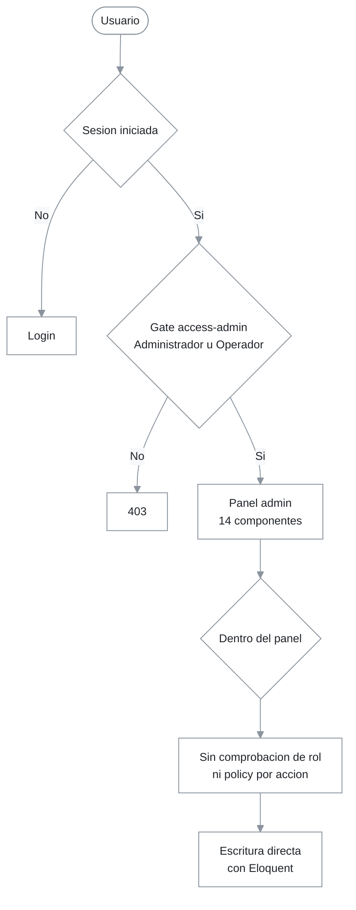
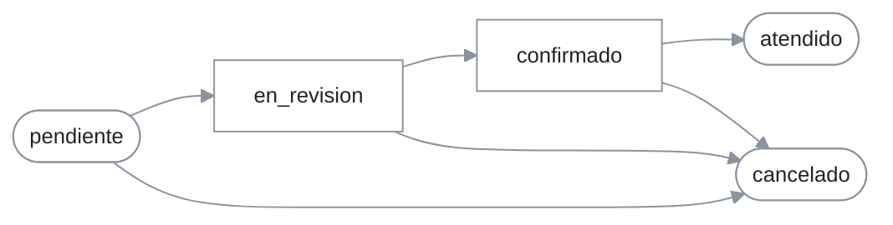

# Módulo back-office administrativo (panel admin)

## 1. Resumen y propósito de negocio

El panel permite al personal de FILAM CENTROPLAST gestionar catálogo, pedidos, descuentos, clientes, usuarios, contenido institucional, banners, reportes y las consolas de solicitudes de stock y reclamaciones. Son 14 componentes Livewire en `app/Livewire/Admin/` servidos bajo el prefijo `/admin` (15 rutas, porque `ProductoForm` atiende crear y editar). Todos usan el layout `layouts::admin` (`resources/views/layouts/admin.blade.php`) y su menú está en `resources/views/admin/partials/nav.blade.php`.

Hay dos roles internos, `Administrador` y `Operador` (`RoleSeeder`); un cliente es un usuario con `id_rol` nulo. El acceso al panel se decide con el gate `access-admin` (`AppServiceProvider::boot()`); **dentro** del panel no se distingue entre ambos roles (hallazgo 1, severidad alta).

## 2. Requisitos que implementa

Estado «Implementado» según `docs/MATRIZ_REQUISITOS.md`; títulos de la ERS v1.4.

| Requisito | Componente | Evidencia |
|---|---|---|
| RF-01, RF-02, RF-03, RF-04 Alta, edición, baja lógica y destacado de productos | `ProductoIndex`, `ProductoForm` | `ProductoForm::guardar()`, `ProductoIndex::alternarActivo()`, `ProductoIndex::eliminar()` |
| RF-05, RF-06 Categorías | `CategoriaIndex` | `CategoriaIndex::guardar()`, `CategoriaIndex::eliminar()` |
| RF-16, RF-17 Imágenes múltiples, portada y eliminación | `ProductoForm` | `ProductoForm::guardar()`, `marcarPortada()`, `eliminarImagen()` |
| RF-36, RF-37 Supervisión y filtro de pedidos | `PedidoIndex` | `PedidoIndex::render()` (filtro por texto y estado; no por fechas) |
| RF-38, RF-39 Ciclo de estados y bitácora | `PedidoDetalle` | `PedidoDetalle::cambiarEstado()`, `agregarNota()`, constante `TRANSICIONES` |
| RF-43, RF-44 Políticas y asignación de descuentos | `DescuentoIndex` | `DescuentoIndex::guardar()`, `asignar()` |
| RF-46 Dashboard | `Dashboard` | `Dashboard::render()` (4 contadores) |
| RF-47, RF-48 Usuarios y RBAC | `UsuarioIndex`, gates y policies | `UsuarioIndex::guardar()`, `AppServiceProvider::boot()`; RBAC en el servidor solo a nivel de ruta (hallazgo 1) |
| RF-49 Reportes básicos | `ReporteIndex` | `ReporteIndex::render()` |
| RF-50 Cartera de clientes | `ClienteIndex` | `ClienteIndex::render()` |
| RF-51, RF-52 Contenido y banners | `ContenidoIndex`, `BannerIndex` | `ContenidoIndex::guardar()`, `BannerIndex::guardar()` |
| RF-60, RF-61 Consolas de stock y reclamaciones | `SolicitudStockIndex`, `ReclamacionIndex` | `SolicitudStockIndex::cambiarEstado()`, `ReclamacionIndex::marcar()` |

No verificado como cubierto por este módulo: RF-07 (conteo por categoría), RF-18 (control de carga masiva), RF-37 por rango de fechas, RF-41 y RF-42 (alertas y correo al equipo: ningún componente del panel los dispara; el correo operativo sale desde `Cart::confirmar()`, ver [01-storefront-publico.md](01-storefront-publico.md)).

## 3. Rutas y puntos de entrada

Fuente: `routes/web.php:47-62`. Todas bajo `Route::middleware(['auth', 'can:access-admin'])->prefix('admin')->name('admin.')`. `php artisan route:list` no se pudo ejecutar (sin PHP): ejecutarlo antes de aprobar.

| URI | Nombre | Componente |
|---|---|---|
| `/admin` | `admin.dashboard` | `Dashboard` |
| `/admin/productos` | `admin.productos.index` | `ProductoIndex` |
| `/admin/productos/crear` | `admin.productos.create` | `ProductoForm` |
| `/admin/productos/{producto}/editar` | `admin.productos.edit` | `ProductoForm` |
| `/admin/categorias` | `admin.categorias.index` | `CategoriaIndex` |
| `/admin/pedidos` | `admin.pedidos.index` | `PedidoIndex` |
| `/admin/pedidos/{pedido}` | `admin.pedidos.show` | `PedidoDetalle` |
| `/admin/solicitudes-stock` | `admin.stock.index` | `SolicitudStockIndex` |
| `/admin/reclamaciones` | `admin.reclamaciones.index` | `ReclamacionIndex` |
| `/admin/descuentos` | `admin.descuentos.index` | `DescuentoIndex` |
| `/admin/clientes` | `admin.clientes.index` | `ClienteIndex` |
| `/admin/usuarios` | `admin.usuarios.index` | `UsuarioIndex` |
| `/admin/contenido` | `admin.contenido.index` | `ContenidoIndex` |
| `/admin/banners` | `admin.banners.index` | `BannerIndex` |
| `/admin/reportes` | `admin.reportes.index` | `ReporteIndex` |

El middleware del grupo es exactamente `auth` y `can:access-admin`. Nota: `{pedido}` en `admin.pedidos.show` se resuelve por la clave primaria (`id_pedido`), a diferencia de la ruta pública, que usa `codigo_correlativo`.

## 4. Diagrama de flujo

Lectura: la única barrera por rol está en la ruta. Una vez dentro, un Operador alcanza las mismas acciones que un Administrador (hallazgo 1).

Lectura: transiciones permitidas por `PedidoDetalle::TRANSICIONES`; `atendido` y `cancelado` son finales.

## 5. Catálogo de componentes

| Componente | Responsabilidad y comportamiento verificado |
|---|---|
| `Dashboard` | Cuatro contadores globales: `Producto::count()`, `Categoria::count()`, `Pedido::count()`, `User::count()`. Respetan soft delete. Sin filtros por fecha ni gráficos. |
| `ProductoIndex` | Búsqueda `ilike` por nombre o SKU, `paginate(10)`. `alternarActivo()` invierte `activo`; `eliminar()` hace soft delete (`Producto` usa `SoftDeletes`). Sin auditoría. |
| `ProductoForm` | Crea y edita. Reglas: SKU único (máx. 35), `nombre` máx. 150, `precio_base` `nullable\|numeric\|min:0`, `stock_estado` en `disponible,stock_bajo,agotado_por_consultar`, imágenes `jpeg,png,webp` máx. 5120 KB. Sincroniza categorías, guarda imágenes en disco `public` y marca portada. Registra auditoría `guardar`. El precio inicial del formulario es `'0'`, no nulo (hallazgo 4). |
| `CategoriaIndex` | CRUD en la misma pantalla; el slug se genera desde el nombre solo al crear. `eliminar()` hace soft delete (`Categoria` usa `SoftDeletes`) y el mensaje dice «desactivada». |
| `PedidoIndex` | Lista de a 10 con búsqueda `ilike` por correlativo o razón social y filtro por `estado_actual` (`pendiente`, `en_revision`, `confirmado`, `atendido`, `cancelado`). |
| `PedidoDetalle` | Carga detalles, cliente, historial y comprobante. `cambiarEstado()` valida contra `TRANSICIONES`, actualiza `estado_actual`, agrega fila en `historial_estados_pedido` con `id_usuario_operador` y registra auditoría `cambio_estado`. `agregarNota()` agrega historial sin auditoría. |
| `SolicitudStockIndex` | Cambia el estado entre `pendiente`, `en_atencion`, `atendida` y asigna `id_usuario_asignado`. Sin auditoría. |
| `ReclamacionIndex` | `marcar()` admite `en_atencion` y `respondido`; al responder fija `fecha_respuesta` y siempre `id_usuario_atendio`. Sin auditoría. |
| `DescuentoIndex` | CRUD de `PoliticaDescuento` (`tipo_descuento` en `porcentaje,monto_fijo`); `eliminar()` solo desactiva; `asignar()` crea `ClienteDescuento` activo (muestra las últimas 20 asignaciones). No impide asignaciones duplicadas. |
| `ClienteIndex` | Lista de solo lectura de a 10, con búsqueda por razón social o documento y `withCount('pedidos')`. |
| `UsuarioIndex` | Alta y edición de usuarios con rol (`id_rol` existente), contraseña mínima 8 (opcional al editar). `bloquear()` hace soft delete del usuario, salvo el propio. |
| `ContenidoIndex` | Edita en bloque los registros de `contenido_institucional` por `clave` (`updateOrCreate`), guardando `id_usuario`. |
| `BannerIndex` | CRUD de banners; imagen obligatoria al crear (`jpeg,png,webp`, máx. 5120 KB) en disco `public`; `eliminar()` borra la fila (`Banner` no usa `SoftDeletes`). |
| `ReporteIndex` | Rango de fechas (por defecto, desde el inicio del mes hasta hoy): total de pedidos, monto de `total_neto`, conteo por estado y ranking de los 10 productos con más unidades (por `nombre_comercial_congelado`). |

Los gates `access-admin`, `manage-catalog` y `manage-users` y las policies `PedidoPolicy`, `ProductoPolicy` y `UserPolicy` se definen en `AppServiceProvider::boot()` y `app/Policies/`; su uso real se analiza en el hallazgo 1.

## 6. Reglas de negocio

| Código | Regla | Cita en código |
|---|---|---|
| RN-AD-01 | Solo Administrador u Operador entran a `/admin` | `AppServiceProvider::boot()` (gate `access-admin`), `routes/web.php:47` |
| RN-AD-02 | El ciclo de pedido es `pendiente` → `en_revision` → `confirmado` → `atendido`, con `cancelado` posible hasta `confirmado`; ninguna otra transición | `PedidoDetalle::TRANSICIONES`, `cambiarEstado()` |
| RN-AD-03 | Cada cambio de estado deja una fila de historial y una de auditoría | `PedidoDetalle::cambiarEstado()` |
| RN-AD-04 | El SKU de producto es único | `ProductoForm::rules()` |
| RN-AD-05 | La baja de productos, categorías y usuarios es lógica (soft delete); descuentos se desactivan; banners se borran | `ProductoIndex::eliminar()`, `CategoriaIndex::eliminar()`, `UsuarioIndex::bloquear()`, `DescuentoIndex::eliminar()`, `BannerIndex::eliminar()` |
| RN-AD-06 | Un usuario no puede bloquearse a sí mismo | `UsuarioIndex::bloquear()` |
| RN-AD-07 | Imágenes: solo `jpeg`, `png` o `webp`, hasta 5 MB | `ProductoForm::rules()`, `BannerIndex::rules()` |
| RN-AD-08 | Una nueva carga de imágenes de producto reasigna la portada a la elegida (o a la primera) | `ProductoForm::guardar()` |
| RN-AD-09 | La contraseña de un usuario administrativo exige al menos 8 caracteres | `UsuarioIndex::rules()` |

## 7. Persistencia

| Tabla | Modelo | Escritura desde el panel |
|---|---|---|
| `productos`, `producto_categoria`, `imagenes_producto` | `Producto`, `ImagenProducto` | `ProductoForm`, `ProductoIndex` |
| `categorias` | `Categoria` | `CategoriaIndex` |
| `pedidos`, `historial_estados_pedido` | `Pedido`, `HistorialEstadoPedido` | `PedidoDetalle` |
| `solicitudes_stock`, `reclamaciones` | `SolicitudStock`, `Reclamacion` | `SolicitudStockIndex`, `ReclamacionIndex` |
| `politicas_descuento`, `cliente_descuento` | `PoliticaDescuento`, `ClienteDescuento` | `DescuentoIndex` |
| `users`, `roles` | `User`, `Role` | `UsuarioIndex` |
| `contenido_institucional`, `banners` | `ContenidoInstitucional`, `Banner` | `ContenidoIndex`, `BannerIndex` |
| `registro_auditoria` | `RegistroAuditoria` | `AuditoriaService::registrar()` desde `ProductoForm` y `PedidoDetalle` |
| Disco `public` | — | `productos/` y `banners/` (`ProductoForm`, `BannerIndex`) |

Detalle de columnas: [02-base-de-datos.md](../01-arquitectura/02-base-de-datos.md).

## 8. Correo, colas y notificaciones

Ningún componente del panel envía correo ni encola trabajos (no hay `Mail::` ni `dispatch` de jobs en `app/Livewire/Admin/`). Los correos de pedido salen desde el storefront: ver [01-storefront-publico.md](01-storefront-publico.md), sección 8.

## 9. Pruebas que lo cubren

Ejecutar con `php artisan test --compact`; resultado no verificado en esta auditoría (sin PHP).

| Prueba | Archivo | Qué demuestra |
|---|---|---|
| `test_admin_area_requires_authentication_and_role`, `test_cliente_cannot_access_admin_area` | `tests/Feature/AdminTest.php` | RN-AD-01 |
| `test_admin_creates_a_category`, `test_admin_creates_a_product_with_image` | `tests/Feature/AdminTest.php` | Alta de categoría y producto con imagen |
| `test_admin_can_advance_order_state_with_audit`, `test_invalid_state_transition_is_rejected` | `tests/Feature/PedidoAdminTest.php` | RN-AD-02 y RN-AD-03 |
| `test_administrador_puede_gestionar_catalogo`, `test_operador_no_gestiona_catalogo_pero_accede_al_panel`, `test_cliente_no_accede_al_panel_administrativo` | `tests/Feature/RbacTest.php` | Gates y policies evaluados de forma aislada con `Gate::forUser()` |

Sin prueba: dashboard, reportes, descuentos, usuarios, banners, contenido, clientes, consolas de stock y reclamaciones, baja lógica y que un Operador sea rechazado al ejecutar una acción de administrador (la prueba de RBAC no recorre componentes).

## 10. Limitaciones y hallazgos

| # | Hecho verificado | Cita | Impacto | Recomendación |
|---|---|---|---|---|
| 1 | Ningún componente de `app/Livewire/Admin/` ni vista admin invoca `authorize`, `Gate::`, `->can(` o `@can`; el único control es `can:access-admin` en la ruta. Los gates `manage-catalog` y `manage-users` y las policies existen sin uso en el panel. El menú no oculta opciones por rol | `routes/web.php:47`, `AppServiceProvider::boot()`, `resources/views/admin/partials/nav.blade.php` | Un Operador puede crear, editar y bloquear usuarios, cambiar su propio rol o el de otros, y gestionar catálogo, descuentos y contenido. Severidad alta (RF-48) | Añadir `Gate::authorize('manage-users')` / `manage-catalog` en las acciones y `mount()` y un `@can` en el menú; agregar pruebas por componente |
| 2 | `AuditoriaService` se usa solo en `ProductoForm::guardar()` y `PedidoDetalle::cambiarEstado()`; `eliminar`, `alternarActivo`, usuarios, descuentos, banners y consolas no auditan | `app/Services/AuditoriaService.php`, `ProductoForm::guardar()`, `PedidoDetalle::cambiarEstado()` | Acciones sensibles sin traza | Auditar altas, bajas y cambios de rol |
| 3 | `ProductoIndex::alternarActivo()` y `eliminar()` operan por id sin autorización | `ProductoIndex` | Cualquier usuario con acceso al panel desactiva o elimina productos | Ver hallazgo 1 |
| 4 | `ProductoForm::$precio_base` inicia en `'0'`; `guardar()` solo convierte `''` en `null`. Un producto nuevo guardado sin tocar el campo queda con precio 0, no «por consultar» | `ProductoForm::$precio_base`, `ProductoForm::guardar()`, [ADR-0006](../../decisiones/0006-precio-nulo-consultar-bloqueo-pedido.md) | Un precio 0 pasa `tienePrecio()` y se puede vender a S/ 0.00 | Iniciar el campo vacío |
| 5 | `eliminarImagen()` borra la fila pero no el archivo del disco `public` | `ProductoForm::eliminarImagen()` | Archivos huérfanos en `storage` | Eliminar el archivo con `Storage::delete()` |
| 6 | `DescuentoIndex::asignar()` no valida que el cliente no tenga ya el descuento; `CartService::descuento()` aplica solo la primera asignación vigente | `DescuentoIndex::asignar()`, `CartService::descuento()` | Asignaciones duplicadas sin efecto claro | Validar duplicados o permitir una sola vigente |
| 7 | `PedidoIndex` filtra por texto y estado pero no por fechas, aunque RF-37 los incluye | `PedidoIndex::render()` | RF-37 cubierto parcialmente | Añadir filtro de fechas |
| 8 | `UsuarioIndex::bloquear()` hace soft delete: el usuario no puede iniciar sesión, pero el correo sigue ocupado por la unicidad de la columna | `UsuarioIndex::bloquear()`, `UsuarioIndex::rules()` | No se puede reutilizar el correo de un usuario bloqueado. No verificado: comportamiento exacto de la regla `unique` con soft delete | Ignorar eliminados o ofrecer restaurar |
