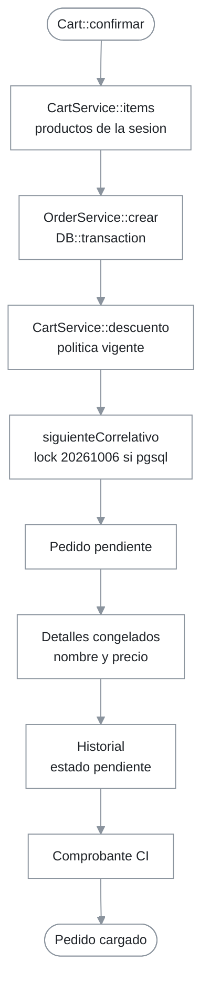

# Servicios core del dominio (carrito, pedidos y auditoría)

## 1. Resumen y propósito de negocio

Tres servicios concentran la lógica de compra: `CartService` (carrito en sesión, subtotales y descuento), `OrderService` (conversión del carrito en pedido congelado con correlativo y comprobante) y `AuditoriaService` (bitácora de acciones). Los consumen los componentes `Cart` y `AddToCart` del storefront ([01-storefront-publico.md](01-storefront-publico.md)) y `ProductoForm` y `PedidoDetalle` del panel ([02-panel-admin.md](02-panel-admin.md)). Este módulo también documenta las vistas de apoyo: correos (`resources/views/emails/`), el comprobante PDF (`resources/views/pdf/`) y los componentes Blade `estado-pedido` y `stock-badge` (`resources/views/components/`).

Decisiones relacionadas: [ADR-0001](../../decisiones/0001-correlativo-pedidos-advisory-lock.md) (correlativo con advisory lock), [ADR-0004](../../decisiones/0004-carrito-en-sesion-http.md) (carrito en sesión) y [ADR-0006](../../decisiones/0006-precio-nulo-consultar-bloqueo-pedido.md) (precio nulo).

## 2. Requisitos que implementa

| Requisito | Cómo lo cumple | Evidencia |
|---|---|---|
| RF-27 Agregar al carrito | Acumula cantidad por producto en la sesión | `CartService::add()` |
| RF-28 Actualizar y quitar ítems | `update()` (cantidad `<= 0` elimina), `remove()`, `clear()` | `CartService::update()` |
| RF-29 Subtotales y totales | `items()`, `subtotal()`, `total()` redondeados a 2 decimales | `CartService::items()` |
| RF-30, RF-33 Solicitud con observaciones | Pedido `pendiente` con `observaciones_entrega` | `OrderService::crear()` |
| RF-31 Congelamiento | Copia nombre, precio unitario y subtotal en `detalle_pedidos` | `OrderService::crear()` |
| RF-32 Correlativo único | `PED-AAAA-NNNNN` bajo lock | `OrderService::siguienteCorrelativo()` (`OrderService.php:62-78`) |
| RF-40 Comprobante interno | Fila en `comprobantes_internos` (`CI-...`) y PDF con la leyenda «DOCUMENTO DE CONTROL INTERNO – NO VÁLIDO PARA FINES TRIBUTARIOS» | `OrderService::crear()`, `resources/views/pdf/comprobante.blade.php:26` |
| RF-43..RF-45 Aplicación de descuento | Primera asignación vigente con política activa | `CartService::descuento()`, `Cliente::descuentosVigentes()` |

El envío del correo transaccional (RF-35) lo hace `Cart::confirmar()`, no estos servicios.

## 3. Rutas y puntos de entrada

Los servicios no exponen rutas. Se inyectan o se resuelven con `app()`:

| Servicio | Llamado desde |
|---|---|
| `CartService` | `AddToCart::agregar()`, `Cart` (`incrementar`, `decrementar`, `eliminar`, `confirmar`), `CartCount`, y `OrderService` (constructor) |
| `OrderService` | `Cart::confirmar()` |
| `AuditoriaService` | `ProductoForm::guardar()`, `PedidoDetalle::cambiarEstado()` (vía `app(AuditoriaService::class)`) |

Las rutas que llegan a ellos están en [01-storefront-publico.md](01-storefront-publico.md) (`/carrito`) y [02-panel-admin.md](02-panel-admin.md).

## 4. Diagrama de flujo

Lectura: todo ocurre en una sola transacción; si falla cualquier escritura, no queda pedido parcial. El carrito se limpia después, fuera del servicio (`Cart::confirmar()`).

## 5. Catálogo de componentes

### 5.1. `CartService` (`app/Services/CartService.php`)

Almacena en la sesión la clave `cart` con un mapa `id_producto => cantidad` (`CartService.php:11`).

| Método | Comportamiento |
|---|---|
| `raw()` | Devuelve el arreglo de sesión |
| `add(int, int = 1)` | Suma cantidad; el resultado mínimo es 1 (`CartService.php:35`) |
| `update(int, int)` | Cantidad `<= 0` elimina la línea |
| `remove(int)`, `clear()` | Quita una línea o toda la clave `cart` |
| `count()` | Suma de cantidades |
| `items()` | Consulta `Producto` con `whereIn('id_producto', ...)` sin filtrar `activo` (`CartService.php:80-83`); descarta ids inexistentes; subtotal = `round(precio_base * cantidad, 2)` |
| `subtotal()`, `total(?Cliente)` | Suma y resta del descuento, redondeados |
| `tieneSinPrecio()` | `true` si algún producto tiene `precio_base` nulo |
| `descuento(?Cliente)` | `0.0` sin cliente, sin asignación vigente o si el subtotal no alcanza `monto_minimo` (`CartService.php:128`); `porcentaje` o `monto_fijo`, acotado al subtotal |

### 5.2. `OrderService` (`app/Services/OrderService.php`)

- `crear(Cliente, array $items, ?string $observaciones): Pedido`: dentro de `DB::transaction` calcula subtotal desde `$items`, descuento con `CartService::descuento()`, crea el `Pedido` en estado `pendiente`, un `DetallePedido` por ítem con `nombre_comercial_congelado` y `precio_unitario_congelado`, una fila de historial («Pedido registrado por el cliente.») y el `ComprobanteInterno` cuyo número reemplaza `PED-` por `CI-`.
- `siguienteCorrelativo()` (privado): prefijo `PED-<año>-`; solo si el driver es `pgsql` ejecuta `SELECT pg_advisory_xact_lock(20261006)` (`OrderService.php:67-69`); toma el máximo del año y suma 1 sobre los últimos 5 dígitos, con relleno a 5 (`OrderService.php:71-77`).

### 5.3. `AuditoriaService` (`app/Services/AuditoriaService.php`)

`registrar(string $entidad, ?int $idRegistro, string $accion, ?string $estadoPrevio = null)` crea un `RegistroAuditoria` con `auth()->id()`, la IP de la petición y `now()`.

### 5.4. Vistas de apoyo

| Vista | Uso |
|---|---|
| `resources/views/emails/pedido-cliente.blade.php`, `pedido-operativo.blade.php` | Cuerpo de `PedidoCliente` y `PedidoOperativo` |
| `resources/views/emails/reclamacion.blade.php`, `contacto.blade.php` | Cuerpo de `ReclamacionCopia` y `ContactoMensaje` (ver storefront) |
| `resources/views/pdf/comprobante.blade.php` | Comprobante interno descargado con DomPDF (`PedidoController::comprobante()`) |
| `resources/views/components/estado-pedido.blade.php` | Etiqueta visual del estado del pedido |
| `resources/views/components/stock-badge.blade.php` | Etiqueta visual de `stock_estado` |

No verificado: el contenido visual de estas vistas más allá de la leyenda del comprobante y la estructura de la tabla del correo del cliente.

## 6. Reglas de negocio

| Código | Regla | Cita en código |
|---|---|---|
| RN-SV-01 | El carrito vive en la sesión bajo la clave `cart` | `CartService::SESSION_KEY` |
| RN-SV-02 | Agregar nunca deja la cantidad por debajo de 1 | `CartService::add()` |
| RN-SV-03 | Una cantidad `<= 0` al actualizar elimina la línea | `CartService::update()` |
| RN-SV-04 | El descuento aplica solo con cliente, asignación activa dentro de fechas, política activa y subtotal `>= monto_minimo` | `CartService::descuento()`, `Cliente::descuentosVigentes()` |
| RN-SV-05 | El descuento nunca supera el subtotal | `CartService::descuento()` |
| RN-SV-06 | El pedido congela nombre y precio unitario; cambiar el producto después no altera el pedido | `OrderService::crear()` |
| RN-SV-07 | Todo pedido nace `pendiente` con una fila de historial | `OrderService::crear()` |
| RN-SV-08 | El correlativo es `PED-AAAA-NNNNN`, reinicia por año y se serializa con el lock `20261006` en PostgreSQL | `OrderService::siguienteCorrelativo()` |
| RN-SV-09 | El comprobante hereda el número del pedido con prefijo `CI-` | `OrderService::crear()` |
| RN-SV-10 | Pedido, detalles, historial y comprobante se crean en una sola transacción | `OrderService::crear()` |

## 7. Persistencia

| Tabla | Modelo | Quién escribe |
|---|---|---|
| Sesión (`cart`) | — | `CartService` |
| `pedidos` | `Pedido` | `OrderService::crear()` |
| `detalle_pedidos` | `DetallePedido` | `OrderService::crear()` |
| `historial_estados_pedido` | `HistorialEstadoPedido` | `OrderService::crear()` (primera fila) y `PedidoDetalle` |
| `comprobantes_internos` | `ComprobanteInterno` | `OrderService::crear()` |
| `registro_auditoria` | `RegistroAuditoria` | `AuditoriaService::registrar()` |
| `clientes`, `cliente_descuento`, `politicas_descuento` | `Cliente`, `ClienteDescuento`, `PoliticaDescuento` | Solo lectura desde `CartService::descuento()` |

Detalle de columnas: [02-base-de-datos.md](../01-arquitectura/02-base-de-datos.md). La migración `database/migrations/2026_10_19_023442_make_precio_base_nullable_on_productos_table.php` hace `precio_base` nullable ([ADR-0006](../../decisiones/0006-precio-nulo-consultar-bloqueo-pedido.md)).

## 8. Correo, colas y notificaciones

Los servicios no envían correo ni encolan trabajos. Los correos del flujo de compra los dispara `Cart::confirmar()` después de `OrderService::crear()` (ver [01-storefront-publico.md](01-storefront-publico.md), sección 8).

## 9. Pruebas que lo cubren

Ejecutar con `php artisan test --compact`; resultado no verificado en esta auditoría (sin PHP).

| Prueba | Archivo | Qué demuestra |
|---|---|---|
| `test_add_to_cart_stores_the_product` | `tests/Feature/CartTest.php` | RN-SV-01 |
| `test_confirmar_creates_order_with_frozen_prices_and_comprobante` | `tests/Feature/CartTest.php` | RN-SV-06, RN-SV-07, RN-SV-09 |
| `test_preferential_discount_is_applied` | `tests/Feature/CartTest.php` | RN-SV-04 |
| `test_product_without_price_cannot_be_added_to_cart`, `test_confirming_order_with_unpriced_product_is_rejected` | `tests/Feature/CartTest.php` | Bloqueo de precio nulo (en componentes, no en el servicio) |
| `test_admin_can_advance_order_state_with_audit` | `tests/Feature/PedidoAdminTest.php` | `AuditoriaService::registrar()` desde `PedidoDetalle` |

Sin prueba: `CartService` de forma aislada (`update`, `remove`, topes de descuento por `monto_minimo` y `monto_fijo`), la concurrencia del correlativo y el reinicio anual.

## 10. Limitaciones y hallazgos

| # | Hecho verificado | Cita | Impacto | Recomendación |
|---|---|---|---|---|
| 1 | `CartService::items()` no filtra `activo` ni `deleted_at` explícito (el soft delete de `Producto` sí excluye eliminados; un producto solo desactivado sigue cargándose) | `CartService.php:80-83` | Se puede confirmar un pedido con un producto desactivado que ya estaba en la sesión | Filtrar con `activos()` |
| 2 | `OrderService::crear()` no valida precio nulo: usa `precio_base` tal cual en `precio_unitario_congelado` | `OrderService::crear()`, `CartService::items()` | Con un llamador distinto de `Cart` la creación fallaría tarde, por la restricción `NOT NULL` de `detalle_pedidos.precio_unitario_congelado` (`2026_10_06_100012_create_detalle_pedidos_table.php:17`), con un error de base de datos en vez de un mensaje claro | Validar con `tienePrecio()` dentro del servicio |
| 3 | `OrderService::crear()` calcula `$subtotal` desde `$items` pero el descuento con `CartService::descuento()`, que vuelve a leer la sesión | `OrderService.php:21-23` | Si `$items` difiere del carrito en sesión, el descuento se calcula sobre otro subtotal | Pasar el subtotal al cálculo del descuento |
| 4 | El año del correlativo usa `now()->year` con zona horaria de la aplicación `UTC` | `OrderService.php:64`, `config/app.php:68` | Un pedido hecho en Perú (UTC-5) después de las 19:00 del 31 de diciembre recibe el año siguiente | Usar la zona `America/Lima` para el año |
| 5 | El lock `pg_advisory_xact_lock` solo se toma con driver `pgsql`; en otros drivers (p. ej. pruebas en SQLite) no hay serialización | `OrderService.php:67-69` | La concurrencia del correlativo no se prueba en CI | Prueba de concurrencia en PostgreSQL |
| 6 | El correlativo se calcula con `max()` sobre texto y `substr(..., -5)`; superar `99999` pedidos al año rompería el formato | `OrderService.php:71-77` | Límite práctico de 99 999 pedidos por año | Aceptable para el volumen actual; documentar |
| 7 | `AuditoriaService` no recibe datos previos y posteriores, solo `estado_previo` opcional, y depende de `auth()->id()` y `request()->ip()` | `AuditoriaService::registrar()` | Traza limitada; en consola o colas `id_usuario` sería nulo | Ampliar si se exige trazabilidad detallada |
