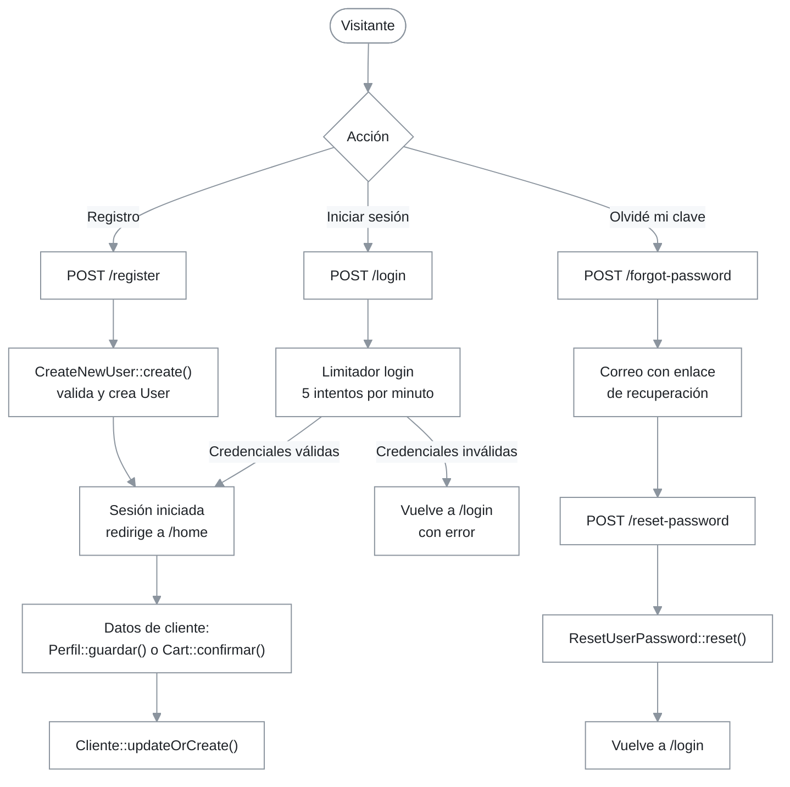

## 1. Resumen y propósito de negocio

Este módulo gestiona el ciclo de identidad de los usuarios del portal: registro de cuentas, inicio y cierre de sesión, recuperación de contraseña y actualización de credenciales. Se apoya en Laravel Fortify (`laravel/fortify ^1.41`, `composer.json:11`), que aporta las rutas y los controladores; el proyecto aporta las acciones de validación en `app/Actions/Fortify/`, las vistas en `resources/views/auth/` y los limitadores de intentos en `FortifyServiceProvider`.

El registro público solo crea la cuenta (`users`). Los datos comerciales del cliente (documento, razón social, teléfono) se completan después, en la pantalla de perfil o al confirmar el primer pedido; ver el apartado 6 y el apartado 10.

## 2. Requisitos que implementa

Los requisitos son los de la ERS (`docs/Ers_FilamCentroPlas_v1.4.docx`); el bloque RF-19 a RF-26 figura como implementado en `docs/MATRIZ_REQUISITOS.md:11`.

| Código | Requisito (ERS) | Cita en código |
|---|---|---|
| `RF-19` | Registro de nuevos clientes | `CreateNewUser::create()` (`app/Actions/Fortify/CreateNewUser.php:23-42`), `resources/views/auth/register.blade.php:18` |
| `RF-20` | Inicio de sesión y autenticación segura | `FortifyServiceProvider::boot()` limitador `login` (`app/Providers/FortifyServiceProvider.php:43-47`), `resources/views/auth/login.blade.php:24` |
| `RF-21` | Cierre seguro de sesión y control de tokens | formularios `POST route('logout')` en `resources/views/layouts/app.blade.php:18`, `layouts/admin.blade.php:30` y `layouts/front.blade.php:32` |
| `RF-22` | Recuperación de contraseña por correo | `ResetUserPassword::reset()` (`app/Actions/Fortify/ResetUserPassword.php:22-31`), vistas `auth/forgot-password.blade.php` y `auth/reset-password.blade.php` |
| `RF-23` | Actualización de perfil y datos de contacto | `UpdateUserProfileInformation::update()` y `UpdateUserPassword::update()`; la interfaz usa `App\Livewire\Perfil` (ver apartado 10) |

## 3. Rutas y puntos de entrada

Las rutas de autenticación no están en `routes/web.php`: las registra el paquete `laravel/fortify` con las URI por defecto (`config/fortify.php:89` define `'prefix' => ''` y no redefine rutas) y el middleware `web` (`config/fortify.php`, clave `middleware`). El paquete añade por su cuenta los filtros `guest` o `auth` según la ruta. La lista vigente se obtiene con `php artisan route:list`.

| Método | URI | Nombre | Acción o vista | Control adicional |
|---|---|---|---|---|
| `GET` | `/login` | `login` | `auth.login` (`FortifyServiceProvider.php:38`) | `guest` |
| `POST` | `/login` | `login` | controlador del paquete | limitador `login`, 5 por minuto |
| `POST` | `/logout` | `logout` | controlador del paquete | `auth` |
| `GET` | `/register` | `register` | `auth.register` (`FortifyServiceProvider.php:39`) | `guest` |
| `POST` | `/register` | `register` | `CreateNewUser::create()` (`FortifyServiceProvider.php:32`) | `guest` |
| `GET` | `/forgot-password` | `password.request` | `auth.forgot-password` (`FortifyServiceProvider.php:40`) | `guest` |
| `POST` | `/forgot-password` | `password.email` | controlador del paquete | `guest` |
| `GET` | `/reset-password/{token}` | `password.reset` | `auth.reset-password` (`FortifyServiceProvider.php:41`) | `guest` |
| `POST` | `/reset-password` | `password.update` | `ResetUserPassword::reset()` (`FortifyServiceProvider.php:35`) | `guest` |
| `PUT` | `/user/profile-information` | definida por el paquete | `UpdateUserProfileInformation::update()` (`FortifyServiceProvider.php:33`) | `auth` |
| `PUT` | `/user/password` | definida por el paquete | `UpdateUserPassword::update()` (`FortifyServiceProvider.php:34`) | `auth` |

Tras iniciar sesión o registrarse, Fortify redirige a `/home` (`config/fortify.php:76`; `tests/Feature/AuthTest.php`, aserciones `assertRedirect('/home')`). La ruta `home` está en `routes/web.php:37`, dentro del grupo `auth`.

## 4. Diagrama de flujo

## 5. Catálogo de componentes

- **`App\Actions\Fortify\PasswordValidationRules`** (trait, `app/Actions/Fortify/PasswordValidationRules.php:8-19`): `passwordRules(): array` devuelve `required`, `string`, `Password::default()` y `confirmed`. Lo usan `CreateNewUser`, `ResetUserPassword` y `UpdateUserPassword`.
- **`App\Actions\Fortify\CreateNewUser`** (`app/Actions/Fortify/CreateNewUser.php:12-43`): `create(array $input): User`. Valida `name` (`required`, `string`, `max:255`), `email` (`required`, `string`, `email`, `max:255`, único en `users`) y `password` (`passwordRules()`). Crea el `User` con la contraseña cifrada con `Hash::make()`. No asigna rol, no crea `Cliente` y no registra consentimiento.
- **`App\Actions\Fortify\ResetUserPassword`** (`app/Actions/Fortify/ResetUserPassword.php:11-32`): `reset(User $user, array $input): void`. Valida `password` con `passwordRules()` y guarda el nuevo hash con `forceFill()`.
- **`App\Actions\Fortify\UpdateUserPassword`** (`app/Actions/Fortify/UpdateUserPassword.php:11-35`): `update(User $user, array $input): void`. Exige `current_password:web` además de `passwordRules()`; los errores van al bag `updatePassword`.
- **`App\Actions\Fortify\UpdateUserProfileInformation`** (`app/Actions/Fortify/UpdateUserProfileInformation.php:12-61`): `update(User $user, array $input): void` valida `name` y `email` (único ignorando al propio usuario) y actualiza ambos; el método protegido `updateVerifiedUser()` (`:51-60`) borra `email_verified_at` y reenvía la verificación solo si `User` implementa `MustVerifyEmail`.
- **`App\Providers\FortifyServiceProvider`** (`app/Providers/FortifyServiceProvider.php:17-61`): en `boot()` enlaza las cuatro acciones (`:32-35`), la redirección de doble factor (`:36`), las cuatro vistas `auth.*` (`:38-41`) y define tres limitadores: `login` (5 por minuto por correo e IP, `:43-47`), `two-factor` (5 por minuto por sesión, `:49-51`) y `passkeys` (10 por minuto por credencial e IP, `:53-59`).
- **`config/fortify.php`**: guard `web` (`:18`), nombre de usuario `email` (`:48`), correos en minúsculas (`:63`), ruta de inicio `/home` (`:76`), vistas habilitadas, y funciones activas `registration`, `resetPasswords`, `updateProfileInformation` y `updatePasswords` (`:164-170`).
- **Vistas** (`resources/views/auth/`): `login.blade.php` (POST a `login`, enlaces a recuperación y registro), `register.blade.php` (campos `name`, `email`, `password`, `password_confirmation`, `:23-41`), `forgot-password.blade.php` (POST a `password.email`) y `reset-password.blade.php` (POST a `password.update` con el token oculto).

## 6. Reglas de negocio

| Código | Regla | Cita en código |
|---|---|---|
| `RN-AUTH-01` | El registro público crea únicamente la cuenta de usuario con nombre, correo y contraseña; la cuenta nace sin rol (`id_rol` nulo) y sin registro en `clientes`. | `CreateNewUser::create()` (`app/Actions/Fortify/CreateNewUser.php:37-41`); `tests/Feature/AuthTest.php::test_new_users_can_register` |
| `RN-AUTH-02` | El inicio de sesión se limita a 5 intentos por minuto para cada combinación de correo (normalizado) e IP. | `app/Providers/FortifyServiceProvider.php:43-47` |
| `RN-AUTH-03` | El correo es único y no distingue mayúsculas de minúsculas: se guarda en minúsculas y la columna es `citext`. | `config/fortify.php:63`; `database/migrations/2026_10_06_100003_add_filam_fields_to_users_table.php:18`; ADR-0002 |
| `RN-AUTH-04` | Toda contraseña nueva por los flujos de Fortify exige confirmación y cumple `Password::default()`. El proyecto no llama a `Password::defaults()`, por lo que aplica la regla por defecto de Laravel. | `app/Actions/Fortify/PasswordValidationRules.php:15-18` |
| `RN-AUTH-05` | Cambiar la contraseña desde Fortify exige la contraseña actual. | `app/Actions/Fortify/UpdateUserPassword.php:25` |
| `RN-AUTH-06` | La baja de un usuario es lógica: `users` no tiene campo de estado y se usa `deleted_at`. | `database/migrations/2026_10_06_100003_add_filam_fields_to_users_table.php:15`; `app/Models/User.php:20` |
| `RN-AUTH-07` | Los datos comerciales del cliente se crean o actualizan al guardar el perfil o al confirmar un pedido, con tipo de documento `DNI` o `RUC` y número de documento único entre clientes. | `Perfil::guardar()` (`app/Livewire/Perfil.php:46-79`); `Cart::confirmar()` (`app/Livewire/Cart.php:76-96`) |

## 7. Persistencia

- **Modelos:** `App\Models\User` (con `SoftDeletes`, `app/Models/User.php:17-54`) y `App\Models\Role` (relación `role()`, `User.php:35-38`).
- **Tablas que escribe este módulo:** `users`, `password_reset_tokens` y `sessions`, definidas en `database/migrations/0001_01_01_000000_create_users_table.php:24-30`, más las columnas de `users` agregadas por `2026_10_06_100003_add_filam_fields_to_users_table.php`.
- **Tablas preparadas pero sin uso activo:** las columnas de doble factor en `users` (`2026_10_07_031705_add_two_factor_columns_to_users_table.php`) y la tabla `passkeys` (`2026_10_07_031706_create_passkeys_table.php`); ver el apartado 10.

## 8. Correo, colas y jobs

El enlace de recuperación de contraseña lo envía el mecanismo estándar de Laravel con la configuración de correo del entorno (`.env.example`, claves `MAIL_*`). `User` no define notificaciones propias (`app/Models/User.php`), por lo que este correo no usa los Mailables del proyecto ni se despacha por Horizon.

## 9. Pruebas que lo cubren

| Prueba | Qué verifica |
|---|---|
| `tests/Feature/AuthTest.php::test_login_screen_can_be_rendered` | La pantalla de acceso se muestra. |
| `tests/Feature/AuthTest.php::test_users_can_authenticate` | Credenciales válidas autentican y redirigen a `/home`. |
| `tests/Feature/AuthTest.php::test_users_cannot_authenticate_with_invalid_password` | Una contraseña incorrecta deja al visitante como invitado. |
| `tests/Feature/AuthTest.php::test_new_users_can_register` | Un registro con nombre, correo y contraseña autentica al nuevo usuario. |
| `tests/Feature/PerfilTest.php` | Perfil: requiere sesión, actualiza datos, cambia contraseña con la actual correcta, falla con la incorrecta y exige documento único. |
| `tests/Feature/SeguridadTest.php::test_guest_cannot_access_private_area` | Un invitado no accede al área privada. |

El conjunto completo de pruebas se describe en [01-pruebas.md](../04-operacion/01-pruebas.md). No existen pruebas de recuperación de contraseña ni del límite de intentos de inicio de sesión (búsqueda en `tests/`).

## 10. Limitaciones y hallazgos

| Hecho | Cita | Impacto | Recomendación |
|---|---|---|---|
| El segundo factor y las passkeys no están habilitados: la lista de funciones de Fortify no incluye autenticación de dos factores ni passkeys, y ninguna vista ni código del proyecto los usa. Solo existen las columnas `two_factor_*`, la tabla `passkeys`, la configuración `passkeys` y los limitadores `two-factor` y `passkeys`. | `config/fortify.php:164-170`; `app/Providers/FortifyServiceProvider.php:49-59` | Cualquier documento que presente 2FA o passkeys como funciones disponibles describe algo que hoy no se puede usar. | Habilitar las funciones con su interfaz, o retirar de la documentación que estén operativas. |
| El registro no captura documento de identidad ni consentimiento de datos personales. `ConsentimientoDato::create` aparece en el formulario de contacto, no en el alta de cuenta. | `app/Actions/Fortify/CreateNewUser.php:37-41`; `app/Livewire/Contacto.php:67` | La aceptación de la política de privacidad al crear la cuenta no queda registrada. | Evaluar con el responsable legal si el alta debe registrar el consentimiento. |
| La interfaz de perfil no usa las acciones de Fortify. `Perfil` valida y escribe `users.name` y `users.email` por su cuenta, y cambia la contraseña con una regla propia (`min:8`, `confirmed`, `Hash::check`). Las rutas `PUT /user/profile-information` y `PUT /user/password` siguen activas porque las funciones están habilitadas. | `app/Livewire/Perfil.php:46-79` y `:81-101`; `config/fortify.php:167-169` | Hay dos caminos capaces de modificar los mismos datos con reglas distintas: el de la interfaz no aplica `Password::default()` ni la regla `current_password:web`. | Mantener `Perfil` como punto único en la interfaz y alinear sus reglas con `PasswordValidationRules`, o delegar en las acciones de Fortify. |
| La rama de verificación de correo de `UpdateUserProfileInformation` no se ejecuta: `User` no implementa `MustVerifyEmail` y `Features::emailVerification()` está comentada. | `app/Actions/Fortify/UpdateUserProfileInformation.php:35-37` y `:51-60`; `config/fortify.php:167` | Sin efecto funcional; es código heredado de la plantilla de Fortify. | Dejar como está, o eliminar la rama si se confirma que no se usará la verificación. |
| Tras iniciar sesión, todos los usuarios, incluidos los clientes, llegan a `/home`, una vista genérica de bienvenida. | `config/fortify.php:76`; `routes/web.php:37` | La ruta `home` y su vista pueden duplicar a `inicio`, la portada pública. | Resolver junto con la decisión sobre las vistas sin dueño. |
