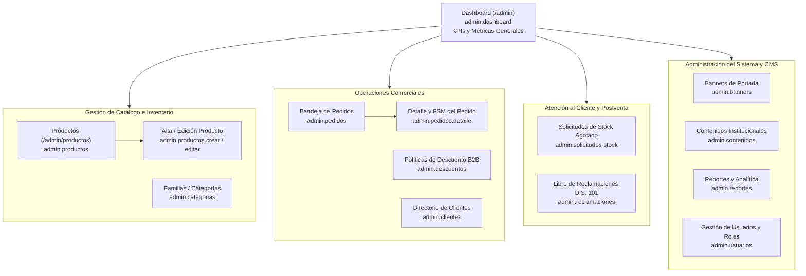

# Módulo Back-Office Administrativo (Panel Admin)

> **Ubicación:** `docs/webada/02-modulos/panel-admin.md`  
> **Módulo:** Panel Administrativo Interno (`App\Livewire\Admin`)  
> **Seguridad:** Middleware `auth` + Gate `can:access-admin`  
> **Fuente de Verdad:** Componentes en `app/Livewire/Admin/`, Policies en `app/Policies/`, `routes/web.php`

---

## 1. Visión General del Panel de Administración

El módulo administrativo permite la gestión operativa y comercial de **Filam Centroplas**. Está protegido en el enrutador por:
```php
Route::middleware(['auth', 'can:access-admin'])
    ->prefix('admin')
    ->name('admin.')
    ->group(function () { ... });
```
Cada componente Livewire v4 adopta el atributo de diseño de plantilla administrativa:
```php
#[Layout('layouts::admin')]
#[Title('Título de la Sección')]
```

---

## 2. Matriz Cruzada de Permisos RBAC y Políticas

El sistema define dos roles internos mediante la tabla `roles`:
- **`Administrador`:** Control total sobre catálogo, configuración, usuarios, descuentos y reportes.
- **`Operador`:** Gestión operativa de pedidos, atención de solicitudes de stock, respuesta al libro de reclamaciones y consulta de clientes.

### 2.1. Matriz de Autorización por Funcionalidad

| Módulo / Acción Administrativa | Componente Livewire | Gate / Policy Involucrada | Rol `Administrador` | Rol `Operador` |
|---|---|---|:---:|:---:|
| **Acceso al Panel (`/admin`)** | Todos | Gate `access-admin` | ✅ Sí | ✅ Sí |
| **Dashboard de Métricas** | `Dashboard` | Gate `access-admin` | ✅ Sí | ✅ Sí |
| **Bandeja de Pedidos** | `PedidoIndex` | `PedidoPolicy::viewAny` | ✅ Sí | ✅ Sí |
| **Detalle y Cambio de Estado de Pedido** | `PedidoDetalle` | `PedidoPolicy::view` / `update` | ✅ Sí | ✅ Sí |
| **Eliminar Pedidos del Sistema** | N/A | `PedidoPolicy::delete` | ✅ Sí | ❌ No |
| **Listar Catálogo Interno** | `ProductoIndex` | `ProductoPolicy::viewAny` | ✅ Sí | ✅ Sí |
| **Crear / Editar Productos** | `ProductoForm` | `ProductoPolicy::create` / `update` | ✅ Sí | ❌ No |
| **Eliminar / Desactivar Productos** | `ProductoIndex` | `ProductoPolicy::delete` | ✅ Sí | ❌ No |
| **CRUD de Categorías** | `CategoriaIndex` | Gate `manage-catalog` | ✅ Sí | ❌ No |
| **Gestión de Políticas de Descuento B2B** | `DescuentoIndex` | Gate `access-admin` | ✅ Sí | ❌ No |
| **Directorio de Clientes Comerciales** | `ClienteIndex` | Gate `access-admin` | ✅ Sí | ✅ Consulta |
| **Atención de Solicitudes de Stock** | `SolicitudStockIndex` | Gate `access-admin` | ✅ Sí | ✅ Sí |
| **Atención de Libro de Reclamaciones** | `ReclamacionIndex` | Gate `access-admin` | ✅ Sí | ✅ Sí |
| **Gestión de Usuarios Internos (RBAC)** | `UsuarioIndex` | `UserPolicy` / Gate `manage-users` | ✅ Sí | ❌ No |
| **Gestión de CMS y Banners** | `ContenidoIndex` / `BannerIndex` | Gate `access-admin` | ✅ Sí | ❌ No |
| **Reportes Analíticos de Ventas** | `ReporteIndex` | Gate `access-admin` | ✅ Sí | ✅ Sí |
| **Monitoreo de Colas (Horizon)** | Horizon UI (`/horizon`) | Gate `viewHorizon` | ✅ Sí | ❌ No |

---

## 3. Catálogo de los 14 Componentes Administrativos



---

### 3.1. `Dashboard` (`app/Livewire/Admin/Dashboard.php`)
- **Ruta:** `GET /admin` (`route('admin.dashboard')`)
- **Funcionalidad:** Renderiza métricas clave en tiempo real:
  - `totalProductos`: `Producto::count()`
  - `totalCategorias`: `Categoria::count()`
  - `totalPedidos`: `Pedido::count()`
  - `totalUsuarios`: `User::count()`
- **Vista Blade:** `resources/views/livewire/admin/dashboard.blade.php`.

---

### 3.2. `PedidoIndex` (`app/Livewire/Admin/PedidoIndex.php`)
- **Ruta:** `GET /admin/pedidos` (`route('admin.pedidos.index')`)
- **Paginación:** `WithPagination` (10 pedidos por página, orden descendente por `fecha_emision`).
- **Propiedades Reactivas:**
  - `public string $search = '';` (Búsqueda por correlativo `PED-AAAA-` o razón social del cliente mediante `ilike`).
  - `public string $estado = '';` (Filtro por estado actual: `'pendiente'`, `'en_revision'`, `'confirmado'`, `'atendido'`, `'cancelado'`).
- **Métodos:** `updatingSearch()` y `updatingEstado()` restablecen la paginación con `$this->resetPage()`.

---

### 3.3. `PedidoDetalle` (`app/Livewire/Admin/PedidoDetalle.php`)
- **Ruta:** `GET /admin/pedidos/{pedido}` (`route('admin.pedidos.show')`)
- **Funcionalidad:** Gestión del ciclo de vida del pedido e historial de auditoría.
- **Constante de Transiciones de la FSM:**
  ```php
  private const TRANSICIONES = [
      'pendiente'   => ['en_revision', 'cancelado'],
      'en_revision' => ['confirmado', 'cancelado'],
      'confirmado'  => ['atendido', 'cancelado'],
      'atendido'    => [],
      'cancelado'   => [],
  ];
  ```
- **Métodos Principales:**
  - `cambiarEstado()`:
    - Valida que `$nuevoEstado` pertenezca a `transicionesDisponibles()`.
    - Actualiza `pedidos.estado_actual`.
    - Inserta en `historial_estados_pedido` con el operador actual y nota explicativa.
    - Notifica a `AuditoriaService::registrar('pedidos', $id, 'cambio_estado', $estadoPrevio)`.
  - `agregarNota()`: Agrega una anotación interna a la bitácora sin modificar el estado del pedido.

---

### 3.4. `ProductoIndex` (`app/Livewire/Admin/ProductoIndex.php`)
- **Ruta:** `GET /admin/productos` (`route('admin.productos.index')`)
- **Paginación:** 10 productos por página ordenados por `id_producto DESC`.
- **Filtro de Búsqueda:** Búsqueda textual sobre `nombre` y `codigo_sku`.
- **Acciones Rápidas:**
  - `alternarActivo(int $id)`: Conmuta el flag booleano `activo` sin salir del listado.
  - `eliminar(int $id)`: Ejecuta borrado suave (`$producto->delete()`).

---

### 3.5. `ProductoForm` (`app/Livewire/Admin/ProductoForm.php`)
- **Rutas:**
  - `GET /admin/productos/crear` (`route('admin.productos.create')`)
  - `GET /admin/productos/{producto}/editar` (`route('admin.productos.edit')`)
- **Subida de Archivos:** Trait `WithFileUploads` para galerías múltiples.
- **Validaciones:**
  ```php
  'codigo_sku' => ['required', 'string', 'max:35', Rule::unique('productos', 'codigo_sku')->ignore($this->producto?->id_producto, 'id_producto')],
  'nombre' => 'required|string|max:150',
  'precio_base' => 'required|numeric|min:0',
  'stock_estado' => 'required|in:disponible,stock_bajo,agotado_por_consultar',
  'imagenes.*' => 'image|mimes:jpeg,png,webp|max:5120',
  ```
- **Persistencia:**
  - Actualiza o crea el registro en `productos`.
  - Sincroniza familias mediante `$producto->categorias()->sync($this->categoriasSeleccionadas)`.
  - Guarda imágenes en `storage/app/public/productos` e inserta en `imagenes_producto`.
  - Permite marcar y desmarcar portada (`marcarPortada()`) o eliminar fotografías (`eliminarImagen()`).
  - Notifica a `AuditoriaService::registrar('productos', $producto->id_producto, 'guardar')`.

---

### 3.6. `CategoriaIndex` (`app/Livewire/Admin/CategoriaIndex.php`)
- **Ruta:** `GET /admin/categorias` (`route('admin.categorias.index')`)
- **Funcionalidad:** ABM de categorías en línea con generación automática de slug (`updatedNombre`).
- **Validaciones:** Slug único en `categorias` ignorando el ID en edición.

---

### 3.7. `ClienteIndex` (`app/Livewire/Admin/ClienteIndex.php`)
- **Ruta:** `GET /admin/clientes` (`route('admin.clientes.index')`)
- **Funcionalidad:** Directorio de clientes comerciales con conteo agregado de pedidos (`withCount('pedidos')`) y búsqueda por razón social o documento.

---

### 3.8. `DescuentoIndex` (`app/Livewire/Admin/DescuentoIndex.php`)
- **Ruta:** `GET /admin/descuentos` (`route('admin.descuentos.index')`)
- **Doble Responsabilidad:**
  1. **CRUD de Políticas:** Creación y edición de reglas (`nombre`, `tipo_descuento` `%` o `fijo`, `valor`, `monto_minimo`).
  2. **Asignación a Clientes (`asignar`):** Vincula un cliente con una política en la tabla `cliente_descuento`.

---

### 3.9. `SolicitudStockIndex` (`app/Livewire/Admin/SolicitudStockIndex.php`)
- **Ruta:** `GET /admin/solicitudes-stock` (`route('admin.stock.index')`)
- **Funcionalidad:** Gestión y atención de prospectos por quiebre de stock.
- **Acción:** `cambiarEstado(int $id, string $estado)`: Transiciona entre `'pendiente'`, `'en_atencion'` y `'atendida'`, registrando el usuario operador asignado.

---

### 3.10. `ReclamacionIndex` (`app/Livewire/Admin/ReclamacionIndex.php`)
- **Ruta:** `GET /admin/reclamaciones` (`route('admin.reclamaciones.index')`)
- **Funcionalidad:** Bandeja del Libro de Reclamaciones Virtual.
- **Acción:** `marcar(int $id, string $estado)`:
  - Cambia a `'en_atencion'` o `'respondido'`.
  - Si pasa a `'respondido'`, fija automáticamente `fecha_respuesta = now()->toDateString()` y guarda el operador responsable (`id_usuario_atendio`).

---

### 3.11. `UsuarioIndex` (`app/Livewire/Admin/UsuarioIndex.php`)
- **Ruta:** `GET /admin/usuarios` (`route('admin.usuarios.index')`)
- **Funcionalidad:** Administración de accesos y roles internos.
- **Reglas de Seguridad:**
  - Exige contraseña de mínimo 8 caracteres al crear.
  - Salvaguarda anti-bloqueo: `bloquear(int $id)` prohíbe que el administrador en sesión se bloquee o elimine a sí mismo (`$id === auth()->id()`).

---

### 3.12. `BannerIndex` (`app/Livewire/Admin/BannerIndex.php`)
- **Ruta:** `GET /admin/banners` (`route('admin.banners.index')`)
- **Funcionalidad:** Subida y ordenamiento de banners promocionales con previsualización temporal (`WithFileUploads`).

---

### 3.13. `ContenidoIndex` (`app/Livewire/Admin/ContenidoIndex.php`)
- **Ruta:** `GET /admin/contenido` (`route('admin.contenido.index')`)
- **Funcionalidad:** Editor masivo de textos corporativos institucionales (`mision`, `vision`, `resena`, `politicas`) mapeados por clave única.

---

### 3.14. `ReporteIndex` (`app/Livewire/Admin/ReporteIndex.php`)
- **Ruta:** `GET /admin/reportes` (`route('admin.reportes.index')`)
- **Analítica Comercial:**
  - Filtro por rango de fechas (`$desde`, `$hasta`), inicializado por defecto en el primer día del mes corriente hasta la fecha actual.
  - Indicadores calculados:
    - Volumen total de pedidos en el periodo.
    - Monto total facturado / emitido en soles (`sum('total_neto')`).
    - Distribución agregada de pedidos por estado (`groupBy('estado_actual')`).
    - **Top 10 Productos Más Demandados:** Suma agregada de unidades congeladas en `detalle_pedidos` agrupadas por `nombre_comercial_congelado`.
