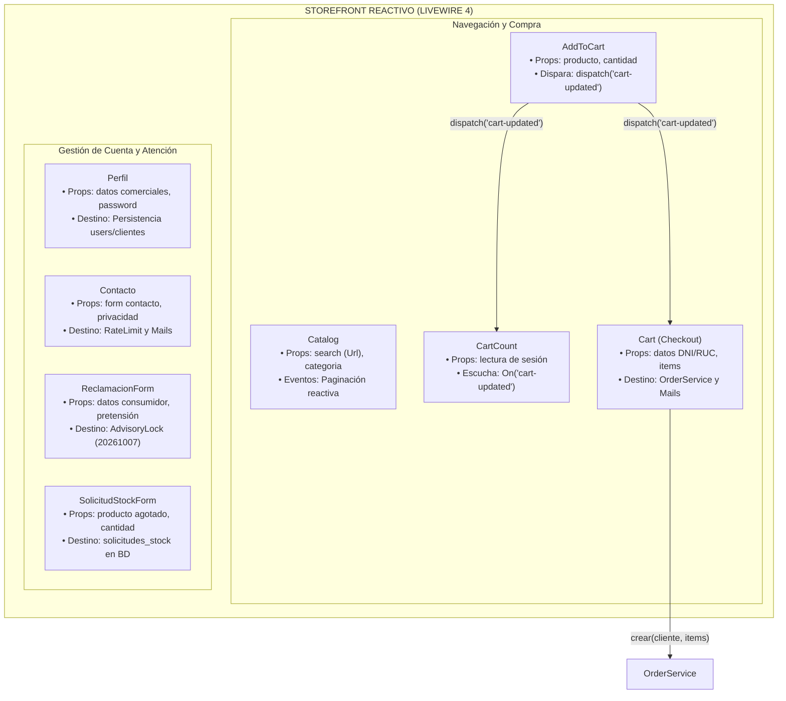
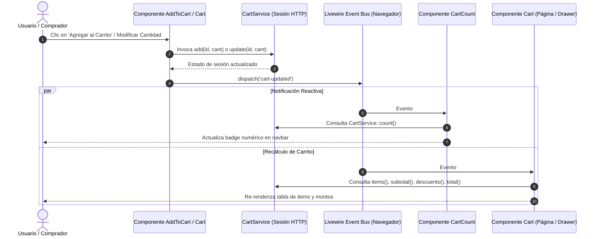

# Módulo Storefront Público y Canales de Atención

> **Ubicación:** `docs/webada/02-modulos/storefront-publico.md`  
> **Módulo:** Front-Office Comercial  
> **Fuente de Verdad:** `app/Http/Controllers/`, `app/Livewire/`, `app/Mail/`, `resources/views/`

---

## 1. Visión General del Front-Office

El **Storefront Público** de Filam Centroplas está diseñado para combinar la velocidad de indexación y renderizado en servidor (SSR) para SEO en motores de búsqueda, con la reactividad en tiempo real de **Livewire 4** para las interacciones de compra y atención al cliente.

La capa de presentación frontal se estructura en:
1. **Controladores HTTP Clásicos:** Rutas de entrada, ficha técnica y exportación de comprobantes PDF.
2. **Componentes Reactivos Livewire:** Catálogo filtrable, carrito de compras, perfil comercial, libro de reclamaciones y solicitudes de stock.
3. **Clases Mailable Asíncronas (`ShouldQueue`):** Despacho desacoplado de confirmaciones y copias legales hacia Redis/Horizon.

---

## 2. Controladores HTTP Frontales

### 2.1. `HomeController` (`app/Http/Controllers/HomeController.php`)
- **Ruta:** `GET /` (`route('inicio')`)
- **Vista Renderizada:** `resources/views/front/home.blade.php`
- **Flujo Operativo:**
  - Consulta los 8 productos destacados activos ordenados:
    ```php
    $destacados = Producto::query()
        ->activos()
        ->where('destacado', true)
        ->orderBy('orden')
        ->take(8)
        ->get();
    ```
  - Carga categorías activas ordenadas para la navegación por familias (PVC, HDPE, Accesorios).
  - Carga banners promocionales activos para el carrusel de cabecera.
  - Carga los bloques de `ContenidoInstitucional` indexados por `clave` (`keyBy('clave')`) para mostrar reseñas corporativas de la planta de Hualhuas.

---

### 2.2. `ProductoController` (`app/Http/Controllers/ProductoController.php`)
- **Ruta:** `GET /producto/{producto}` (`route('producto.show')`)
- **Enlace de Modelo:** Resuelve implícitamente por `slug` (`Producto::getRouteKeyName()`).
- **Vista Renderizada:** `resources/views/front/producto.blade.php`
- **Flujo Operativo:**
  - Protege productos no publicados: `abort_unless($producto->activo, 404)`.
  - Carga ansiosa (*Eager Loading*): `$producto->load(['imagenes', 'categorias'])`.
  - Consulta contextual de hasta 4 productos relacionados que compartan las mismas categorías:
    ```php
    $relacionados = Producto::query()
        ->activos()
        ->whereKeyNot($producto->getKey())
        ->when($categoriaIds->isNotEmpty(), fn ($query) => $query->whereHas(
            'categorias',
            fn ($query) => $query->whereIn('categorias.id_categoria', $categoriaIds),
        ))
        ->orderBy('orden')
        ->take(4)
        ->get();
    ```

---

### 2.3. `PedidoController` (`app/Http/Controllers/PedidoController.php`)
- **Middleware:** `auth` (Requiere inicio de sesión).
- **Rutas Asociadas:**
  - `GET /mi-cuenta/pedidos` (`route('pedidos.index')`): Renderiza `front.pedidos.index` paginando 10 pedidos del cliente autenticado.
  - `GET /pedido/{pedido:codigo_correlativo}` (`route('pedido.show')`): Valida autorización con `Gate::authorize('view', $pedido)`, carga ansiosa de `['detalles', 'cliente', 'comprobante', 'historial']` y renderiza `front.pedidos.show`.
  - `GET /pedido/{pedido:codigo_correlativo}/comprobante` (`route('pedido.comprobante')`): Autoriza mediante política y compila en memoria el PDF utilizando `Barryvdh\DomPDF\Facade\Pdf::loadView('pdf.comprobante', ['pedido' => $pedido])`, descargando `comprobante-PED-AAAA-NNNNN.pdf`.

---

## 3. Catálogo de Componentes Livewire Públicos



#### Diagrama de Secuencia de Reactividad y Eventos


---

### 3.1. `Catalog` (`app/Livewire/Catalog.php`)
- **Propósito:** Catálogo digital con filtros dinámicos y sincronización en la URL del navegador.
- **Propiedades Reactivas:**
  - `#[Url(as: 'q')] public string $search = '';` (Búsqueda textual vinculada al parámetro GET `?q=`).
  - `#[Url] public ?string $categoria = null;` (Filtro por slug de categoría `?categoria=`).
- **Ciclo de Vida y Métodos:**
  - `updatingSearch()` y `updatingCategoria()`: Invocan `$this->resetPage()` para regresar a la primera página ante cambios de filtro.
  - `limpiarFiltros()`: Resetea búsqueda y categoría activa.
- **Lógica de Consulta:**
  - Filtra productos con `activos()`.
  - Búsqueda insensible a mayúsculas con PostgreSQL `ilike` en `nombre`, `codigo_sku` y `descripcion_corta`.
  - Paginación reactiva de 9 elementos por página (`paginate(9)`).
- **Vista Blade:** `resources/views/livewire/catalog.blade.php`.

---

### 3.2. `AddToCart` (`app/Livewire/AddToCart.php`)
- **Propósito:** Selector numérico de cantidad y adición al carrito con control de disponibilidad referencial.
- **Propiedades Reactivas:**
  - `public Producto $producto;`
  - `public int $cantidad = 1;`
- **Métodos:**
  - `mount(Producto $producto)`: Inicializa el componente con el modelo inyectado.
  - `agregar(CartService $cart)`:
    - Si `$producto->stock_estado === 'agotado_por_consultar'`, bloquea la acción agregando error de validación: `'Producto agotado. Puedes solicitar disponibilidad por WhatsApp.'`.
    - Invoca `$cart->add($this->producto->id_producto, max(1, $this->cantidad))`.
    - Restablece `$cantidad = 1`.
    - Dispara el evento global: `$this->dispatch('cart-updated')`.
    - Emite mensaje flash: `session()->flash('cart_ok', 'Producto agregado al carrito.')`.
- **Vista Blade:** `resources/views/livewire/add-to-cart.blade.php`.

---

### 3.3. `CartCount` (`app/Livewire/CartCount.php`)
- **Propósito:** Badge indicador del total de artículos en el carrito ubicado en la barra de navegación.
- **Atributo Reactivo de Escucha:**
  ```php
  #[On('cart-updated')]
  public function refresh(): void
  {
      // Provoca el re-renderizado automático del componente
  }
  ```
- **Lógica de Render:** Inyecta `$cart->count()` (suma de cantidades en sesión) en `resources/views/livewire/cart-count.blade.php`.

---

### 3.4. `Cart` (`app/Livewire/Cart.php`)
- **Propósito:** Consola de checkout, edición de cantidades en línea, cálculo de descuentos y confirmación formal del pedido.
- **Propiedades Reactivas:**
  - `$tipo_documento` (`'DNI'` o `'RUC'`), `$numero_documento`, `$razon_social`, `$telefono`, `$direccion`, `$observaciones`.
- **Reglas de Validación (`confirmar`):**
  ```php
  'tipo_documento'   => 'required|in:DNI,RUC',
  'numero_documento' => ['required', 'string', 'max:20', Rule::unique('clientes', 'numero_documento')->ignore($clienteId, 'id_cliente')],
  'razon_social'     => 'required|string|max:150',
  'telefono'         => 'nullable|string|max:20',
  'direccion'        => 'nullable|string|max:255',
  'observaciones'    => 'nullable|string|max:1000',
  ```
- **Métodos Principales:**
  - `incrementar(int $idProducto, CartService $cart)`: Suma 1 unidad y emite `cart-updated`.
  - `decrementar(int $idProducto, CartService $cart)`: Resta 1 unidad y emite `cart-updated`.
  - `eliminar(int $idProducto, CartService $cart)`: Remueve el item y emite `cart-updated`.
  - `confirmar(CartService $cart, OrderService $orders)`:
    - Valida que el carrito no esté vacío.
    - Actualiza o crea el registro en `clientes` asociado a `auth()->id()`.
    - Invoca a `OrderService::crear(...)` para generar atómicamente el pedido y comprobante.
    - Despacha los correos asíncronos `PedidoCliente` y `PedidoOperativo`.
    - Limpia la sesión con `$cart->clear()` y emite `cart-updated`.
    - Redirige mediante SPA fast navigation: `$this->redirectRoute('pedido.show', ['pedido' => $pedido->codigo_correlativo], navigate: true)`.
- **Vista Blade:** `resources/views/livewire/cart.blade.php`.

---

### 3.5. `Perfil` (`app/Livewire/Perfil.php`)
- **Propósito:** Edición de perfil de usuario, datos tributarios/comerciales y cambio seguro de contraseña.
- **Validaciones:**
  - `name`: Requerido, máx. 150 caracteres.
  - `email`: Requerido, formato email, único en `users` ignorando el usuario actual.
  - `tipo_documento`: `DNI` o `RUC`.
  - `numero_documento`: Único en tabla `clientes`.
  - `password`: Mínimo 8 caracteres, confirmado con `password_confirmation`, validando `current_password` mediante `Hash::check()`.
- **Vista Blade:** `resources/views/livewire/perfil.blade.php`.

---

### 3.6. `Contacto` (`app/Livewire/Contacto.php`)
- **Propósito:** Formulario institucional de contacto y consultas comerciales.
- **Seguridad:** Rate limiting defensivo de 5 intentos por minuto por IP (`RateLimiter::tooManyAttempts('contacto:'.$ip, 5)`).
- **Tratamiento de Datos Personales (Ley 29733):**
  - Exige aceptación explícita: `'acepta' => 'accepted'`.
  - Registra el consentimiento previo en `consentimientos_datos` con finalidad `'contacto'`, versión de política `'1.0'`, IP y User-Agent.
- **Persistencia y Correo:**
  - Inserta en `mensajes_contacto` vinculando `id_consentimiento`.
  - Despacha `Mail::to(config('mail.from.address'))->send(new ContactoMensaje($mensaje))`.
- **Vista Blade:** `resources/views/livewire/contacto.blade.php`.

---

### 3.7. `ReclamacionForm` (`app/Livewire/ReclamacionForm.php`)
- **Propósito:** Hoja de Reclamación Virtual conforme al D.S. 101-2022-PCM y Ley N.° 29571.
- **Seguridad y Rate Limiting:** 5 intentos por minuto por IP.
- **Generación Atómica de Correlativo:**
  - Bloqueo consultivo de PostgreSQL: `SELECT pg_advisory_xact_lock(20261007)`.
  - Formato legal continuo: `LR-AAAA-NNNN` (e.g. `LR-2026-0001`).
- **Plazo Legal Obligatorio:** Calcula automáticamente la fecha de vencimiento sumando 15 días hábiles exactos:
  ```php
  'fecha_limite_respuesta' => now()->addWeekdays(15)->toDateString(),
  ```
- **Notificación:** Despacha `ReclamacionCopia` con acuse de recibo simultáneamente al consumidor y a la casilla oficial de atención al cliente (`config('filam.ventas_email')`).
- **Vista Blade:** `resources/views/livewire/reclamacion-form.blade.php`.

---

### 3.8. `SolicitudStockForm` (`app/Livewire/SolicitudStockForm.php`)
- **Propósito:** Modal reactivo para registrar solicitudes de stock formal sobre productos en estado `'agotado_por_consultar'`.
- **Propiedades:** `$producto`, `$nombres_contacto`, `$correo`, `$telefono`, `$cantidad_requerida`.
- **Persistencia:** Crea el registro en `solicitudes_stock` vinculando opcionalmente el cliente autenticado y fijando el estado inicial `'pendiente'`.
- **Vista Blade:** `resources/views/livewire/solicitud-stock-form.blade.php`.

---

## 4. Clases Mailable y Notificaciones (`app/Mail/`)

Todas las comunicaciones por correo electrónico están desacopladas del ciclo HTTP mediante colas asíncronas en Redis supervisadas por Horizon:

| Clase Mailable | Archivo | Implementa `ShouldQueue` | Asunto y Destinatario | Vista Blade |
|---|---|---|---|---|
| **`PedidoCliente`** | `PedidoCliente.php` | **Sí** | *"Confirmación de tu solicitud PED-AAAA-NNNNN"* $\rightarrow$ Cliente | `emails.pedido-cliente` |
| **`PedidoOperativo`** | `PedidoOperativo.php` | **Sí** | *"Nuevo pedido registrado PED-AAAA-NNNNN"* $\rightarrow$ Ventas Filam | `emails.pedido-operativo` |
| **`ReclamacionCopia`**| `ReclamacionCopia.php` | **Sí** | *"Hoja de Reclamación Virtual LR-AAAA-NNNN"* $\rightarrow$ Consumidor + Ventas | `emails.reclamacion-copia` |
| **`ContactoMensaje`** | `ContactoMensaje.php` | No (Directo) | *"Nuevo mensaje de contacto web"* $\rightarrow$ Administración | `emails.contacto-mensaje` |
