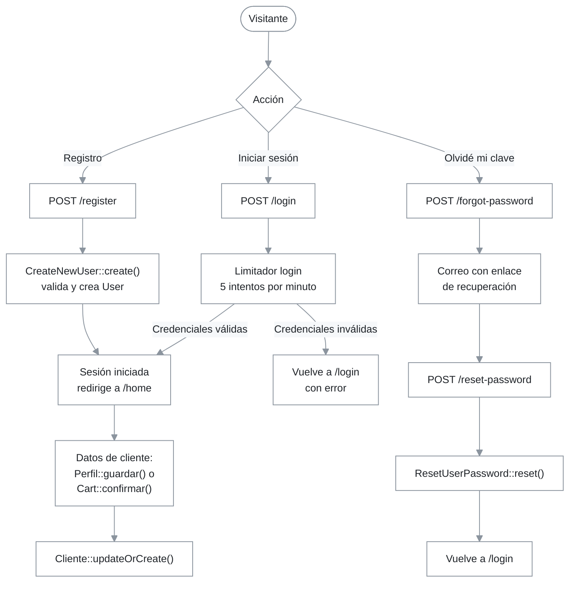

# Módulo: autenticación y ciclo de cuenta (Laravel Fortify)

## 1. Resumen y propósito de negocio

Este módulo gestiona la identidad de quienes entran al portal: registro de cuentas, inicio y cierre de sesión, recuperación de contraseña y cambio de credenciales. Se apoya en Laravel Fortify (`laravel/fortify ^1.41`, `composer.json:11`), que aporta las rutas y los controladores. El proyecto aporta las acciones de validación de `app/Actions/Fortify/`, las vistas de `resources/views/auth/` y los limitadores de intentos de `FortifyServiceProvider`.

El registro público solo crea la cuenta (`users`). Los datos comerciales del cliente (documento, razón social, teléfono) se completan después, en la pantalla de perfil o al confirmar el primer pedido (ver reglas `RN-AUTH-01` y `RN-AUTH-07`).

## 2. Requisitos que implementa

Los requisitos son los de la ERS v1.4 (`docs/Ers_FilamCentroPlas_v1.4.docx`); `docs/MATRIZ_REQUISITOS.md:11` declara el bloque RF-19 a RF-26 como implementado. Este módulo cubre RF-19 a RF-23; RF-24 a RF-26 (historial, detalle y comprobante) pertenecen al módulo de área privada del cliente.

| Requisito (ERS v1.4) | Cómo lo cumple |
|---|---|
| RF-19 Registro de nuevos clientes | `CreateNewUser::create()` (`app/Actions/Fortify/CreateNewUser.php:23-42`) y formulario `resources/views/auth/register.blade.php:18` |
| RF-20 Inicio de sesión y autenticación segura | Limitador `login` en `FortifyServiceProvider::boot()` (`app/Providers/FortifyServiceProvider.php:43-47`) y formulario `resources/views/auth/login.blade.php:24` |
| RF-21 Cierre seguro de sesión y control de tokens | Formularios `POST route('logout')` en `resources/views/layouts/admin.blade.php:30`, `resources/views/layouts/app.blade.php:18` y `resources/views/layouts/front.blade.php:32`. El control de tokens (2FA, passkeys) no está habilitado: ver hallazgo 1 |
| RF-22 Recuperación de contraseña por correo | `ResetUserPassword::reset()` (`app/Actions/Fortify/ResetUserPassword.php:22-31`) y vistas `forgot-password` y `reset-password` |
| RF-23 Actualización de perfil y datos de contacto | La interfaz usa `Perfil::guardar()` y `Perfil::cambiarPassword()` (`app/Livewire/Perfil.php:46-101`); las acciones de Fortify (`UpdateUserProfileInformation::update()`, `UpdateUserPassword::update()`) existen y están enlazadas, pero la interfaz no las usa: ver hallazgo 3 |

## 3. Rutas y puntos de entrada

Las rutas de autenticación no están en `routes/web.php`: las registra el paquete. `config/fortify.php` define `'prefix' => ''` (`:89`) y el middleware `web` (`:104`), y habilita las funciones `registration`, `resetPasswords`, `updateProfileInformation` y `updatePasswords` (`:165-169`). El zip auditado no incluye `vendor/`, por lo que las URI y los nombres de los controladores del paquete no se pudieron comprobar con `route:list`. La columna «Nombre de ruta» solo lista los nombres que las vistas del proyecto usan (`resources/views/auth/*.blade.php`, `resources/views/layouts/*.blade.php`); `—` indica un nombre no verificado. Las URI son las predeterminadas de Fortify. Hay que confirmarlas con `php artisan route:list --path=login`, `--path=register`, `--path=password` y `--path=user` (el filtro `--except-vendor` las oculta).

| Método | URI | Nombre de ruta | Componente/Controlador | Middleware |
|---|---|---|---|---|
| GET | `/login` | `login` | vista `auth.login` (`FortifyServiceProvider.php:38`) | `web`; `guest` por defecto del paquete |
| POST | `/login` | `login` (usado por el formulario, `login.blade.php:24`) | controlador del paquete | `web`; limitador `login` (`config/fortify.php:119`) |
| POST | `/logout` | `logout` | controlador del paquete | `web` |
| GET | `/register` | `register` | vista `auth.register` (`FortifyServiceProvider.php:39`) | `web`; `guest` por defecto del paquete |
| POST | `/register` | `register` (usado por el formulario, `register.blade.php:18`) | `CreateNewUser::create()` (`FortifyServiceProvider.php:32`) | `web`; `guest` por defecto del paquete |
| GET | `/forgot-password` | `password.request` | vista `auth.forgot-password` (`FortifyServiceProvider.php:40`) | `web`; `guest` por defecto del paquete |
| POST | `/forgot-password` | `password.email` | controlador del paquete | `web`; `guest` por defecto del paquete |
| GET | `/reset-password/{token}` | — | vista `auth.reset-password` (`FortifyServiceProvider.php:41`) | `web`; `guest` por defecto del paquete |
| POST | `/reset-password` | `password.update` | `ResetUserPassword::reset()` (`FortifyServiceProvider.php:35`) | `web`; `guest` por defecto del paquete |
| PUT | `/user/profile-information` | — | `UpdateUserProfileInformation::update()` (`FortifyServiceProvider.php:33`) | `web`; `auth` por defecto del paquete |
| PUT | `/user/password` | — | `UpdateUserPassword::update()` (`FortifyServiceProvider.php:34`) | `web`; `auth` por defecto del paquete |
| GET | `/home` | `home` | vista `home` (`resources/views/home.blade.php`) | `web`, `auth` (`routes/web.php:38-39`) |

Tras iniciar sesión o registrarse, Fortify redirige a `/home` (`config/fortify.php:76`; `tests/Feature/AuthTest.php:30` y `:55`). La ruta `home` está en `routes/web.php:39`, dentro del grupo `auth`, renderiza `resources/views/home.blade.php` y utiliza el layout `resources/views/layouts/app.blade.php`.

## 4. Diagrama de flujo

Camino principal: el visitante se registra o inicia sesión y queda autenticado; los datos de cliente se crean después, en el perfil o al confirmar un pedido. Caminos alternos: credenciales inválidas devuelven al formulario con error; superar el límite de 5 intentos por minuto bloquea el intento; la recuperación termina en `/login`, sin iniciar sesión automáticamente.

## 5. Catálogo de componentes

### 5.1. `PasswordValidationRules` (`app/Actions/Fortify/PasswordValidationRules.php:8-19`)

- **Responsabilidad:** trait con las reglas de contraseña compartidas.
- **Acciones públicas:** `passwordRules(): array` devuelve `required`, `string`, `Password::default()` y `confirmed` (`:15-18`). Lo usan `CreateNewUser`, `ResetUserPassword` y `UpdateUserPassword`.
- **Autorización:** no aplica.

### 5.2. `CreateNewUser` (`app/Actions/Fortify/CreateNewUser.php:12-43`)

- **Responsabilidad:** crear la cuenta en el registro público.
- **Acciones públicas:** `create(array $input): User`. Valida `name` (`required`, `string`, `max:255`), `email` (`required`, `string`, `email`, `max:255`, único en `users`) y `password` (`passwordRules()`), y crea el `User` con `Hash::make()` (`:25-41`). No asigna rol, no crea `Cliente` y no registra consentimiento.
- **Autorización:** la ruta es de invitados (comportamiento por defecto del paquete).

### 5.3. `ResetUserPassword` (`app/Actions/Fortify/ResetUserPassword.php:11-32`)

- **Responsabilidad:** guardar la contraseña nueva tras el enlace de recuperación.
- **Acciones públicas:** `reset(User $user, array $input): void` valida `password` con `passwordRules()` y guarda el nuevo hash con `forceFill()` (`:22-31`).

### 5.4. `UpdateUserPassword` (`app/Actions/Fortify/UpdateUserPassword.php:11-35`)

- **Responsabilidad:** cambiar la contraseña de un usuario autenticado.
- **Acciones públicas:** `update(User $user, array $input): void` exige `current_password:web` además de `passwordRules()`; los errores van al bag `updatePassword` (`:24-30`).

### 5.5. `UpdateUserProfileInformation` (`app/Actions/Fortify/UpdateUserProfileInformation.php:12-61`)

- **Responsabilidad:** actualizar nombre y correo de un usuario autenticado.
- **Acciones públicas:** `update(User $user, array $input): void` valida `name` y `email` (único ignorando al propio usuario) y actualiza ambos. El método protegido `updateVerifiedUser()` (`:51-60`) borra `email_verified_at` y reenvía la verificación solo si `User` implementa `MustVerifyEmail` (`:35-37`).

### 5.6. `FortifyServiceProvider` (`app/Providers/FortifyServiceProvider.php:17-61`)

- **Responsabilidad:** enlazar las acciones y las vistas, y definir los limitadores.
- **Acciones públicas:** `boot()` enlaza las cuatro acciones (`:32-35`), la redirección de doble factor (`:36`) y las cuatro vistas `auth.*` (`:38-41`). Define tres limitadores: `login` (5 por minuto por correo e IP, `:43-47`), `two-factor` (5 por minuto por sesión, `:49-51`) y `passkeys` (10 por minuto por credencial e IP, `:53-59`).

### 5.7. `config/fortify.php`

- **Responsabilidad:** parámetros del paquete: guard `web` (`:18`), nombre de usuario `email` (`:48`), correos en minúsculas (`:63`), ruta de inicio `/home` (`:76`), prefijo vacío (`:89`), middleware `web` (`:104`), limitadores (`:118-122`), vistas habilitadas (`:134`) y funciones activas (`:164-170`).

### 5.8. Vistas (`resources/views/auth/`)

- **`login.blade.php`:** POST a `login` (`:24`), con enlaces a recuperación (`:51`) y registro (`:54`).
- **`register.blade.php`:** POST a `register` (`:18`); campos `name`, `email`, `password` y `password_confirmation` (`:23-41`).
- **`forgot-password.blade.php`:** POST a `password.email` (`:27`).
- **`reset-password.blade.php`:** POST a `password.update` con el token oculto (`:18-20`).

### 5.9. Vistas de aterrizaje post-autenticación (`home.blade.php`, `layouts/app.blade.php`)

- **`resources/views/home.blade.php`:** Vista de bienvenida para usuarios autenticados que acceden a `/home`. Muestra el saludo con `auth()->user()->name`, accesos rápidos a catálogo, carrito, pedidos, perfil, panel de administración (bajo `@can('access-admin')`), y resumen de datos de la cuenta (rol, correo y estado).
- **`resources/views/layouts/app.blade.php`:** Plantilla base de la vista `home`, con barra de navegación superior, información del usuario autenticado, enlaces de navegación y botón de cierre de sesión (`POST route('logout')`).

## 6. Reglas de negocio

| Código | Regla | Cita en código |
|---|---|---|
| RN-AUTH-01 | El registro público crea únicamente la cuenta con nombre, correo y contraseña; la cuenta nace sin rol (`id_rol` nulo) y sin registro en `clientes` | `app/Actions/Fortify/CreateNewUser.php:37-41`; `tests/Feature/AuthTest.php::test_new_users_can_register` |
| RN-AUTH-02 | El inicio de sesión se limita a 5 intentos por minuto por cada combinación de correo (en minúsculas) e IP | `app/Providers/FortifyServiceProvider.php:43-47` |
| RN-AUTH-03 | El correo es único y no distingue mayúsculas: la columna es `citext` y Fortify normaliza el nombre de usuario a minúsculas | `config/fortify.php:63`; `database/migrations/2026_10_06_100003_add_filam_fields_to_users_table.php:18`; ADR-0002 |
| RN-AUTH-04 | Toda contraseña nueva por los flujos de Fortify exige confirmación y cumple `Password::default()` | `app/Actions/Fortify/PasswordValidationRules.php:15-18` |
| RN-AUTH-05 | Cambiar la contraseña desde Fortify exige la contraseña actual | `app/Actions/Fortify/UpdateUserPassword.php:25` |
| RN-AUTH-06 | La baja de un usuario es lógica: `users` no tiene campo de estado y se usa `deleted_at` | `database/migrations/2026_10_06_100003_add_filam_fields_to_users_table.php:15`; `app/Models/User.php:20` |
| RN-AUTH-07 | Los datos comerciales del cliente se crean o actualizan al guardar el perfil o al confirmar un pedido, con tipo de documento `DNI` o `RUC` y número de documento único entre clientes | `Perfil::guardar()` (`app/Livewire/Perfil.php:51-76`); `Cart::confirmar()` (`app/Livewire/Cart.php:82-101`) |

## 7. Persistencia

| Tabla | Modelo | Uso en el módulo |
|---|---|---|
| `users` | `App\Models\User` (`SoftDeletes`, `app/Models/User.php:20`; contraseña con cast `hashed`, `:31`) | Alta de cuenta, cambio de contraseña y de perfil. Columnas añadidas por `database/migrations/2026_10_06_100003_add_filam_fields_to_users_table.php` |
| `password_reset_tokens` | sin modelo propio | Tokens de recuperación (`database/migrations/0001_01_01_000000_create_users_table.php:24-28`) |
| `sessions` | sin modelo propio | Sesiones de usuario, con driver `database` (`config/session.php:21`) |
| columnas `two_factor_*` y tabla `passkeys` | sin uso | Preparadas pero sin función activa (`database/migrations/2026_10_07_031705_add_two_factor_columns_to_users_table.php`, `database/migrations/2026_10_07_031706_create_passkeys_table.php`); ver hallazgo 1 |

## 8. Correo, colas y notificaciones

| Clase | Destino | ¿`ShouldQueue`? | Disparador |
|---|---|---|---|
| Notificación estándar de restablecimiento de contraseña del framework | Correo del usuario | no verificado | `POST /forgot-password` (controlador del paquete) |

`User` no define notificaciones propias (`app/Models/User.php`), por lo que este correo no usa los Mailables del proyecto. Si el envío se encola depende del paquete y no se pudo verificar sin `vendor/`.

## 9. Pruebas que lo cubren

| Prueba | Archivo | Qué demuestra |
|---|---|---|
| `test_login_screen_can_be_rendered` | `tests/Feature/AuthTest.php` | La pantalla de acceso se muestra |
| `test_users_can_authenticate` | `tests/Feature/AuthTest.php` | Credenciales válidas autentican y redirigen a `/home` |
| `test_users_cannot_authenticate_with_invalid_password` | `tests/Feature/AuthTest.php` | Una contraseña incorrecta deja al visitante como invitado |
| `test_new_users_can_register` | `tests/Feature/AuthTest.php` | Un registro con nombre, correo y contraseña autentica al nuevo usuario |
| `test_perfil_page_requires_authentication` | `tests/Feature/PerfilTest.php` | El perfil exige sesión |
| `test_user_can_update_profile_and_contact_data` | `tests/Feature/PerfilTest.php` | Se actualizan nombre, correo y datos de cliente |
| `test_user_can_change_password_with_correct_current_password` | `tests/Feature/PerfilTest.php` | El cambio de contraseña funciona con la actual correcta |
| `test_password_change_fails_with_wrong_current_password` | `tests/Feature/PerfilTest.php` | El cambio falla con la contraseña actual incorrecta |
| `test_document_number_must_be_unique_across_clients` | `tests/Feature/PerfilTest.php` | El documento es único entre clientes |
| `test_guest_cannot_access_private_area` | `tests/Feature/SeguridadTest.php` | Un invitado es enviado a `/login` desde `/carrito`, `/mi-cuenta/pedidos` y `/admin` |

El conjunto completo de pruebas se describe en [01-pruebas.md](../04-operacion/01-pruebas.md). Una búsqueda en `tests/` no encuentra pruebas de recuperación de contraseña ni del límite de intentos de inicio de sesión.

## 10. Limitaciones y hallazgos

| # | Hecho verificado | Cita | Impacto | Recomendación |
|---|---|---|---|---|
| 1 | El segundo factor y las passkeys no están habilitados: la lista de funciones de Fortify no los incluye y ninguna vista ni código del proyecto los usa. Solo existen las columnas `two_factor_*`, la tabla `passkeys`, la configuración `passkeys` y los limitadores `two-factor` y `passkeys` | `config/fortify.php:164-170`; `app/Providers/FortifyServiceProvider.php:49-59` | Cualquier documento que presente 2FA o passkeys como funciones disponibles describe algo que hoy no se puede usar | Habilitar las funciones con su interfaz, o dejar claro en la documentación que no están operativas |
| 2 | El registro no captura documento de identidad ni consentimiento de datos personales. `ConsentimientoDato::create` aparece en el formulario de contacto, no en el alta de cuenta | `app/Actions/Fortify/CreateNewUser.php:37-41`; `app/Livewire/Contacto.php:67` | La aceptación de la política de privacidad al crear la cuenta no queda registrada | Evaluar con el responsable legal si el alta debe registrar el consentimiento |
| 3 | La interfaz de perfil no usa las acciones de Fortify. `Perfil` valida y escribe `users.name` y `users.email` por su cuenta y cambia la contraseña con una regla propia (`min:8`, `confirmed`, `Hash::check`). Las rutas `PUT /user/profile-information` y `PUT /user/password` siguen activas porque las funciones están habilitadas | `app/Livewire/Perfil.php:46-79` y `:81-101`; `config/fortify.php:168-169` | Dos caminos pueden modificar los mismos datos con reglas distintas: el de la interfaz no aplica `Password::default()` ni `current_password:web` | Dejar `Perfil` como punto único y alinear sus reglas con `PasswordValidationRules`, o delegar en las acciones de Fortify |
| 4 | La rama de verificación de correo de `UpdateUserProfileInformation` no se ejecuta: `User` no implementa `MustVerifyEmail` y `Features::emailVerification()` está comentada | `app/Actions/Fortify/UpdateUserProfileInformation.php:35-37` y `:51-60`; `config/fortify.php:167` | Sin efecto funcional; es código heredado de la plantilla de Fortify | Dejar como está, o eliminar la rama si se confirma que no se usará la verificación |
| 5 | Tras iniciar sesión, todos los usuarios, incluidos los clientes, llegan a `/home`, una vista genérica | `config/fortify.php:76`; `routes/web.php:39` | La ruta `home` puede duplicar a `inicio`, la portada pública | Resolver junto con la decisión sobre las vistas sin dueño (tarea T3 del encargo, pendiente de autorización) |
| 6 | Las URI, los nombres de ruta y los middleware de las rutas del paquete no se verificaron con `route:list` porque el zip auditado no incluye `vendor/` | `config/fortify.php:89` y `:104` | La tabla del apartado 3 puede diferir de la versión instalada de Fortify | Ejecutar los comandos de `route:list` indicados en el apartado 3 y corregir la tabla |
